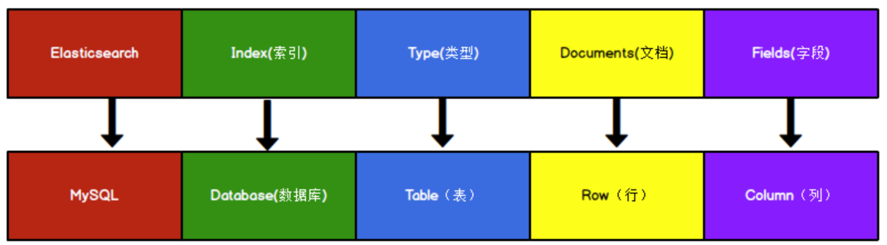

上一节我们介绍了倒排索引的概念，本节将重点讲解`ES`（`Elasticsearch`）的相关内容。

首先，我们需要了解`ES`的基本概念。`ES`是`ELK Stack`中的核心组件之一。`ELK Stack`是由`Elasticsearch`、`Logstash`和`Kibana`三个技术栈组成的，其中`Elasticsearch`（简称`ES`）是一个开源的分布式搜索与分析引擎。

在实际开发中，搜索通常需要支持模糊查询。例如，要查找`name`字段中包含「苹果」的记录，可以使用以下`SQL`语句：

```sql
select * from table where name like "%苹果%";
```

这个查询存在一个明显的问题：即使`name`字段已经建立索引，使用`LIKE "%苹果%"`这样的查询模式仍然会导致索引失效，从而降低查询效率。此外，索引的维护也比较复杂，每次执行`INSERT`或`UPDATE`操作时，都可能触发索引的更新。同时，用户在搜索时可能会使用不同的字段，如果针对每个字段分别设置独立的查询框，不仅会增加界面的复杂度，也会影响用户的搜索体验。

我们希望通过一个通用的查询框来解决上述问题，为此，`Elasticsearch`（简称`ES`）应运而生。

`ES`的核心工作原理是：索引程序会扫描文档中的文本内容，对其中的词语进行分析并建立倒排索引，同时记录词语与文档之间的关联关系，以及词语在文档中出现的频次和位置信息。当用户发起查询时，检索程序会利用预先建立的索引快速查找匹配的文档，并将查询结果返回给用户。这一过程类似于通过书籍末尾的索引查找关键词，再根据索引定位对应的内容。

我们把`ES`的相关概念和关系型数据库（例如`MySQL`）进行一个对比：



在`Elasticsearch`中，文档（`Document`）是存储数据的基本单位，采用`JSON`格式表示。示例如下：

```json
{
  "id": 1001,
  "name": "张三",
  "age": 25,
  "gender": "男",
  "email": "zhangsan@example.com",
  "address": {
    "province": "广东省",
    "city": "深圳市"
  },
  "hobbies": ["阅读", "篮球", "音乐"],
  "create_time": "2026-11-27T10:30:00"
}
```

在`Elasticsearch 6.x`中，每个`Index`下只能包含一个`Type`，而在`Elasticsearch 7.x`中，`Type`的概念已被彻底移除。原本的`Type`类似于关系型数据库中的表，随着`Type`概念的移除，`Index`直接对应于`Mapping`（映射）。

在创建数据库表时，需要定义字段名称、数据类型、长度及约束等信息。同样，在`Elasticsearch`中，也需要定义每个`Index`包含哪些字段，以及这些字段的数据类型和约束信息，这些信息就是`Mapping`。

这就引出了一个疑问：`Mapping`和`Type`看起来功能相似，为什么要将它们区分为两个不同的概念？

这是因为在`Elasticsearch 6.x`前的版本中，一个`Index`下可以包含多个`Type`，每个`Type`实际上对应一套独立的`Mapping`。从`Elasticsearch 6.x`开始，一个`Index`下只能包含一个`Type`，即一个`Index`只能对应一套`Mapping`。因此，`Type`作为独立概念的意义逐渐消失，直接使用`Index`关联`Mapping`即可。