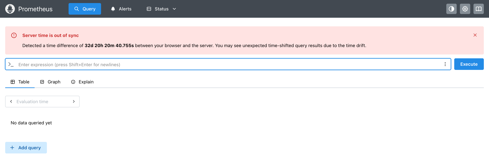
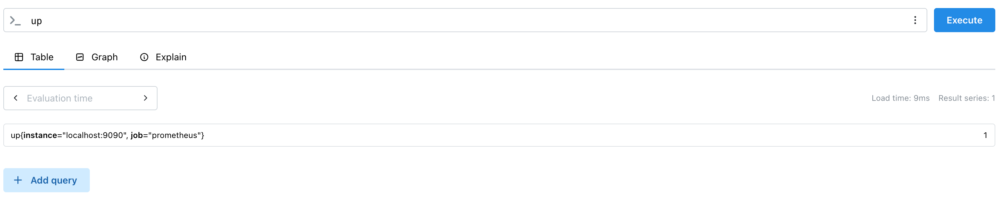

本文介绍如何通过`Docker`快速部署`Prometheus`服务。

`Prometheus`启动时需要指定配置文件`prometheus.yml`。为了实现数据持久化，还需要在宿主机上创建一个目录，用于存储`TSDB`数据。首先，在宿主机上创建这两个目录：

```bash
mkdir -p /opt/prometheus/config
mkdir -p /opt/prometheus/data
```

创建完成后，建议为`data`目录赋予`777`权限，避免容器内的`nobody`用户因权限不足而无法写入数据：

```bash
chmod 777 /opt/prometheus/data
```

在`/opt/prometheus/config`目录下创建`prometheus.yml`配置文件：

```sh
vim /opt/prometheus/config/prometheus.yml
```

该文件内容如下所示：

```yaml
global:
  scrape_interval: 15s
  evaluation_interval: 15s

scrape_configs:
  - job_name: 'prometheus'
    static_configs:
      - targets: ['localhost:9090']
```

上述配置项的含义如下：

- `scrape_interval: 15s`：全局默认的指标抓取间隔为`15`秒，即`Prometheus`每隔`15`秒向监控目标发起一次指标拉取请求。
- `evaluation_interval: 15s`：告警规则的全局评估间隔为`15`秒，即`Prometheus`每隔`15`秒检查一次告警条件是否满足。
- `scrape_configs`：定义监控目标列表。此处先配置`Prometheus`监控自身，目标地址为`localhost:9090`。

使用以下命令，拉取最新版本的`Prometheus`镜像：

```sh
docker pull prom/prometheus:latest
```

创建并启动`Prometheus`容器：

```bash
docker run -d \
  --name prometheus \
  -p 9090:9090 \
  -v /opt/prometheus/config/prometheus.yml:/etc/prometheus/prometheus.yml \
  -v /opt/prometheus/data:/prometheus \
  prom/prometheus:latest \
  --config.file=/etc/prometheus/prometheus.yml \
  --storage.tsdb.path=/prometheus \
  --web.enable-lifecycle
```

后面三个启动参数的含义如下：

- `--config.file=/etc/prometheus/prometheus.yml`：指定`Prometheus`启动时加载的配置文件路径。
- `--storage.tsdb.path=/prometheus`：指定`Prometheus`的`TSDB`数据存储路径，用于保存采集到的时序数据。
- `--web.enable-lifecycle`：启用生命周期管理接口，支持通过`HTTP`请求热加载配置，无需重启容器。

上文的启动命令通过`-v`参数将宿主机的`/opt/prometheus/data`目录挂载到容器内的`/prometheus`目录。这样，`Prometheus`生成的所有`TSDB`数据，包括`chunks`、`wal`、`checkpoint`等，都会持久化存储在宿主机上。如果省略该挂载，删除容器后，存储在容器可写层中的监控数据也会随之丢失。因此，在生产环境中，必须配置数据目录挂载，以确保监控数据的持久化。

执行上述命令后，可以通过以下命令查看容器状态：

```bash
docker ps | grep prometheus
```

打开浏览器，访问`http://localhost:9090`。如果部署在远程服务器上，请将`localhost`替换为服务器的`IP`地址。若能正常显示`Prometheus Web UI`界面，则说明安装成功：



我们看到它上面出现了一条提示，其原文是：

```
Server time is out of sync
Detected a time difference of 32d 20h 20m 52.188s between your browser and the server. You may see unexpected time-shifted query results due to the time drift.
```

其中文翻译是：检测到你的浏览器本地时间与`Prometheus`服务器时间相差`32`天`20`小时`20`分`40.755`秒。由于存在较大的时间偏移，查询指标时可能出现时间错乱、图表时间轴异常以及查询结果不符合预期等问题。

这是因为`Prometheus`服务器未安装或启用`NTP`时间同步服务，或者由于系统时间偏差过大，导致`chrony`按照默认策略拒绝自动进行时间跳变。我们可以执行以下命令，检查是否已安装`chrony`，以及其服务是否正在运行：

```sh
rpm -q chrony
systemctl status chronyd
```

如果服务没有安装，我们使用下面命令进行安装：

```sh
yum install chrony -y
systemctl enable --now chronyd
```

无论服务是否安装并启动，我们都执行下面命令，进行手动同步：

```sh
chronyc -a makestep
```

同步完成后，执行`date`命令，即可查看时间同步是否成功。成功后刷新页面，报错提示即消失。

在页面顶部的查询框中输入`up`，然后按回车或者点击「`Execute`」按钮，可以看到一条结果：



`up`指标的值`1`表示`Prometheus`成功抓取到了该目标，值为`0`则表示抓取失败。

除了上述启动参数外，`Prometheus`还支持以下常用参数：

| 参数                            | 作用                                       | 默认值          |
| ------------------------------- | ------------------------------------------ | --------------- |
| `--storage.tsdb.retention.time` | 数据保留时间                               | `15d`           |
| `--storage.tsdb.retention.size` | 数据最大磁盘占用空间                       | `0`，表示不限制 |
| `--query.max-samples`           | 单次查询允许处理的最大样本数               | `50000000`      |
| `--web.enable-admin-api`        | 启用管理接口，支持删除`TSDB`数据等高级操作 | 默认不启用      |

运行过程中，如果修改了`prometheus.yml`配置文件，无需重启容器，只需向`Prometheus`发送一个`POST`请求：

```bash
curl -X POST http://localhost:9090/-/reload
```

即可重新加载配置并使修改生效。前提是容器启动时必须指定`--web.enable-lifecycle`参数，且通过直接覆盖原文件的方式修改配置文件。由于`vim`默认采用原子保存策略，即先写入临时文件，再通过重命名替换原文件，导致文件的`inode`发生变化。对于绑定挂载的文件，容器内可能仍然引用旧的文件对象，导致读取到的内容未更新，从而使热加载无法生效。

我们可以执行以下命令，修改`vim`的默认行为：

```sh
echo "set backupcopy=yes" >> ~/.vimrc
```

添加该配置后，`vim`会先将原文件复制为备份，再直接覆盖原文件的内容，而不再采用「删除旧文件并创建新文件」的方式，从而保持原文件的`inode`不变。如果不修改`vim`配置，也可以执行`docker restart prometheus`重启容器，确保容器重新读取配置文件。

热加载成功后，`Prometheus`日志中会输出类似`Loading configuration file`的信息。

`HTTP URL`的路径允许使用连字符`-`，它是普通的路径字符，没有特殊的协议含义。`/-/reload`是`Prometheus`定义的特殊接口路径，其中`-`属于路径命名约定，用于区分特殊的生命周期操作接口，例如`/-/healthy`用于健康检查，`/-/ready`用于就绪检查。
