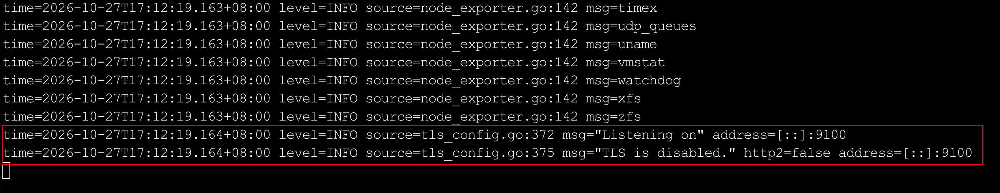
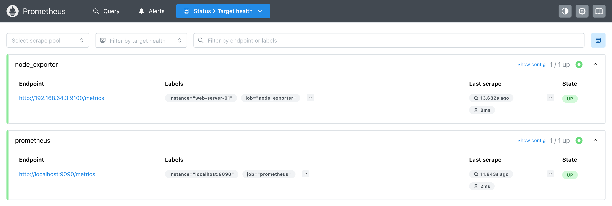
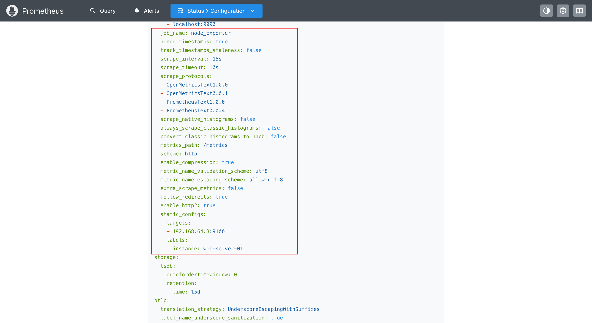

`Node Exporter`是`Prometheus`官方维护的主机指标采集器，主要用于暴露`Linux`等类`Unix`系统的`CPU`、内存、磁盘、`IO`、网络等硬件及内核级指标。本文介绍两种安装方式，即二进制文件部署和`Docker`容器部署。

二进制方式是最传统、最稳定的部署方式，适合生产环境中的物理机或虚拟机。

访问`Node Exporter`的`GitHub Releases`页面：https://github.com/prometheus/node_exporter/releases。

在此页面中找到适合你系统架构的最新版本，以`Linux arm64`为例，执行以下命令：

```bash
cd /opt
wget https://github.com/prometheus/node_exporter/releases/download/v1.12.1/node_exporter-1.12.1.linux-arm64.tar.gz
tar -xzf node_exporter-1.12.1.linux-arm64.tar.gz
mv node_exporter-1.12.1.linux-arm64 node_exporter
```

上述命令将`Node Exporter`下载并解压到`/opt/node_exporter`目录下，可以通过以下命令查看解压后的文件：

```bash
ls /opt/node_exporter
```

在该目录下可以看到一个名为`node_exporter`的可执行文件，这就是主程序，直接运行它即可启动服务：

```bash
/opt/node_exporter/node_exporter
```

默认情况下，`Node Exporter`会监听`9100`端口。如果启动成功，终端会输出如下日志：



此时，为该服务器打开另一个终端，执行以下命令，验证指标是否已正常暴露：

```bash
curl http://localhost:9100/metrics
```

如果返回大量以`# TYPE`和`# HELP`开头的文本数据，说明`Node Exporter`运行正常。

由于前台运行的`Node Exporter`会在终端关闭后停止，因此在生产环境中，需要将其注册为`Systemd`服务，以实现开机自启和后台守护。首先，创建一个专用的运行用户，以遵循最小权限原则，降低服务运行过程中的安全风险：

```bash
useradd --no-create-home --shell /bin/false node_exporter
chown -R node_exporter:node_exporter /opt/node_exporter
```

接着执行以下命令，为`Node Exporter`创建`Systemd`服务文件：

```bash
cat > /etc/systemd/system/node_exporter.service << 'EOF'
[Unit]
Description=Node Exporter
Wants=network-online.target
After=network-online.target

[Service]
User=node_exporter
Group=node_exporter
Type=simple
ExecStart=/opt/node_exporter/node_exporter
Restart=always
RestartSec=5

[Install]
WantedBy=multi-user.target
EOF
```

重新加载`Systemd`配置并启动`Node Exporter`服务：

```bash
systemctl daemon-reload
systemctl start node_exporter
systemctl enable node_exporter
```

验证其服务状态：

```bash
systemctl status node_exporter
```

如果看到`active (running)`，说明服务已成功运行。

`Node Exporter`支持通过启动参数控制采集的指标范围，以下是几个常用参数：

| 参数                           | 作用                              |
| ------------------------------ | --------------------------------- |
| `--web.listen-address`         | 指定监听地址和端口，默认为`:9100` |
| `--collector.disable-defaults` | 禁用所有默认采集器                |
| `--collector.<name>`           | 启用指定采集器                    |
| `--no-collector.<name>`        | 禁用指定采集器                    |

例如，如果只需要采集`CPU`和内存指标，可以使用以下命令启动：

```sh
/opt/node_exporter/node_exporter \
  --collector.disable-defaults \
  --collector.cpu \
  --collector.meminfo
```

如果`Prometheus`本身也是通过`Docker`运行的，那么用`Docker`方式安装`Node Exporter`可以保持一致性，也更方便管理。

首先拉取`Node Exporter`的镜像：

```sh
docker pull prom/node-exporter:latest
```

执行下面命令，启动容器：

```bash
docker run -d \
  --name node_exporter \
  --net="host" \
  --pid="host" \
  -v "/:/host:ro,rslave" \
  prom/node-exporter:latest \
  --path.rootfs=/host
```

`Node Exporter`容器启动参数说明：

- `--net="host"`：使用宿主机网络模式，使`Node Exporter`直接访问宿主机的网络接口信息。
- `--pid="host"`：使用宿主机的`PID`命名空间，使`Node Exporter`能够访问宿主机的进程信息。
- `-v "/:/host:ro,rslave"`：将宿主机的根目录以只读方式挂载到容器内的`/host`目录，使`Node Exporter`能够读取宿主机的文件系统、磁盘等相关数据。其中，`ro`表示只读挂载，禁止容器通过该挂载点修改宿主机文件；`rslave`表示递归从属挂载传播，允许宿主机后续新增的子挂载点传播到容器内，但容器内的挂载变更不会反向传播到宿主机。
- `--path.rootfs=/host`：指定`Node Exporter`使用`/host`作为宿主机的根文件系统路径，以便正确采集宿主机的系统指标。

同样地，如果只需要采集`CPU`和内存指标，可以在启动命令末尾添加相应的采集器参数：

```sh
  --collector.disable-defaults \
  --collector.cpu \
  --collector.meminfo
```

启动后，容器会默认监听`9100`端口，可以通过`curl http://localhost:9100/metrics`验证运行状态。如果返回大量以`# TYPE`和`# HELP`开头的文本数据，则说明`Node Exporter`容器运行正常。

`Node Exporter`启动后，还需要在`Prometheus`的配置文件中添加抓取目标，否则`Prometheus`不会主动拉取其暴露的监控指标。

编辑`Prometheus`的配置文件`prometheus.yml`：

```
vim /opt/prometheus/config/prometheus.yml
```

在`scrape_configs`段落下追加以下内容：

```yaml
  - job_name: 'node_exporter'
    static_configs:
      - targets: ['192.168.64.3:9100']
        labels:
          instance: 'web-server-01'
```

其中`192.168.64.3:9100`是部署`Node Exporter`的主机`IP`和端口，`instance`标签用于在`Prometheus`中标识这台机器。

由于`Prometheus`使用`bridge`网络，而`Node Exporter`使用`host`网络，二者的网络环境不同。`localhost`会指向`Prometheus`容器自身，而非宿主机，因此需要使用宿主机的实际`IP`地址访问`Node Exporter`。

保存配置文件后，执行以下命令，进行热加载：

```bash
curl -X POST http://localhost:9090/-/reload
```

打开`Prometheus`的`Web UI`，进入「`Status`」→「`Target health`」页面，找到`node_exporter`任务：



如果没有看到`node_exporter`任务，可以使用`docker restart prometheus`重启容器，强制刷新容器内配置文件。

在「`Status`」→「`Configuration`」页面，可以看到对应任务的配置信息：



`Node Exporter`暴露了大量监控指标，以下是几个常用指标，可在`Prometheus`的查询框中输入并执行，查看对应的数据：

- `node_cpu_seconds_total`：`CPU`各运行模式（用户态、系统态、空闲等）的累计运行时间。
- `node_memory_MemAvailable_bytes`：当前可用内存的字节数。
- `node_memory_MemTotal_bytes`：总内存的字节数。
- `node_filesystem_avail_bytes`：文件系统可用空间的字节数。
- `node_network_receive_bytes_total`：网卡累计接收的字节数。

也可以使用`PromQL`表达式进行查询，例如，计算过去`5`分钟内各实例的平均`CPU`空闲率：

```promql
avg(irate(node_cpu_seconds_total{mode="idle"}[5m])) by (instance)
```

关于`PromQL`表达式的相关内容，后续章节将进行详细讲解。
