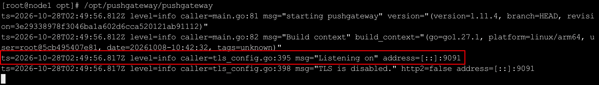
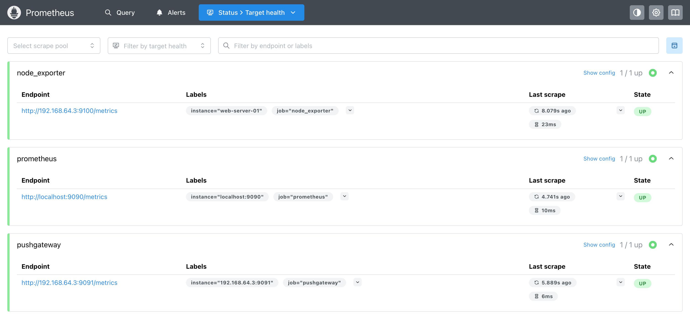

`Pushgateway`是`Prometheus`生态中的一个中间网关组件，用于接收短生命周期任务或批处理脚本主动推送的监控指标。由于`Prometheus`默认采用`Pull`模式，对于执行完成后立即退出的进程，例如定时`CronJob`任务、备份脚本等，`Prometheus`可能无法及时抓取其指标。`Pushgateway`正是为解决这一场景而设计的。

使用`Docker`部署是最快捷的方式，适合测试和学习环境。首先，拉取`Pushgateway`镜像：

```sh
docker pull prom/pushgateway:latest
```

接着，启动容器并将宿主机的`9091`端口映射到容器的`9091`端口：

```bash
docker run -d \
  --name pushgateway \
  -p 9091:9091 \
  -v /opt/pushgateway/data:/data \
  prom/pushgateway:latest \
  --persistence.file=/data/metrics.db \
  --persistence.interval=5m
```

`Pushgateway`支持将指标数据持久化到磁盘，主要通过以下两个启动参数进行配置：

1. `--persistence.file=/data/metrics.db`：指定`Pushgateway`指标数据的持久化文件路径，将指标数据保存到磁盘中。容器重启或重新创建后，只要该文件仍然存在，`Pushgateway`就可以在启动时尝试恢复已保存的指标数据。
2. `--persistence.interval=5m`：设置指标数据持久化写入的最小时间间隔为`5`分钟，减少频繁写盘带来的`I/O`开销。间隔越短，数据更新后通常能更快地持久化，但如果进程异常退出，最近一次持久化之后尚未保存的数据仍可能丢失。

启动后，执行以下命令查看容器运行状态：

```bash
docker ps | grep pushgateway
```

如果更倾向于在宿主机上直接运行，可以通过二进制文件部署。

访问`Pushgateway`的`GitHub Releases`页面：https://github.com/prometheus/pushgateway/releases。

在此页面中找到适合你系统架构的最新版本，以`Linux arm64`为例，执行以下命令：

```bash
cd /opt
wget https://github.com/prometheus/pushgateway/releases/download/v1.11.4/pushgateway-1.11.4.linux-arm64.tar.gz
tar -xzf pushgateway-1.11.4.linux-arm64.tar.gz
mv pushgateway-1.11.4.linux-arm64 pushgateway
```

解压并重命名后，执行以下命令启动`Pushgateway`：

```bash
/opt/pushgateway/pushgateway
```

默认监听`9091`端口。启动成功后会输出如下日志：



生产环境中同样建议配置为`Systemd`服务，方法与前文`Node Exporter`的`Systemd`配置类似，此处不再赘述。

无论使用哪种方式安装，都可以通过以下命令验证`Pushgateway`是否正常运行：

```bash
curl http://localhost:9091/metrics
```

如果返回大量以`# TYPE`和`# HELP`开头的文本数据，则说明`Pushgateway`服务运行正常。

`Pushgateway`提供了一个简单的`Web UI`，可以通过浏览器访问`http://<server-ip>:9091`查看当前已推送的所有指标分组。

`Pushgateway`安装完成后，需要在`Prometheus`的配置文件中将其添加为抓取目标。与普通抓取目标不同，配置`Pushgateway`时强烈建议设置`honor_labels: true`，否则`Prometheus`会使用自身的`job`和`instance`标签覆盖推送方原本携带的同名标签。

编辑`prometheus.yml`配置文件：

```
vim /opt/prometheus/config/prometheus.yml
```

在`scrape_configs`配置项中追加以下内容：

```yaml
  - job_name: 'pushgateway'
    honor_labels: true
    static_configs:
      - targets: ['192.168.64.3:9091']
```

其中`192.168.64.3:9091`是部署`Pushgateway`的主机`IP`和端口。

保存配置后执行热加载：

```bash
curl -X POST http://localhost:9090/-/reload
```

打开`Prometheus`的`Web UI`，进入「`Status`」→「`Target health`」页面，即可找到`Pushgateway`任务：



### 6. 推送指标示例

`Pushgateway`的核心用法是让短任务主动将指标推送到它上面。推送通过标准的`HTTP POST`请求完成，数据格式与`Prometheus`的文本暴露格式一致。

以下是一个用`curl`推送指标的完整示例：

```bash
cat <<EOF | curl --data-binary @- http://localhost:9091/metrics/job/backup/instance/db-primary
# HELP backup_duration_seconds 备份任务耗时
# TYPE backup_duration_seconds gauge
backup_duration_seconds 125.5
# HELP backup_records_total 备份记录数
# TYPE backup_records_total counter
backup_records_total 10240
EOF
```

上述命令的含义如下：

- `http://localhost:9091/metrics/job/backup/instance/db-primary`：推送的`URL`路径。`job`和`instance`是`Pushgateway`的分组维度，用于区分不同任务和来源。
- `--data-binary @-`：将标准输入的内容作为原始二进制数据发送。
- 正文部分遵循`Prometheus`文本格式，包含`HELP`、`TYPE`和指标数据。

推送成功后，你可以在`Pushgateway`的`Web UI`（`http://localhost:9091`）中看到`job="backup"`、`instance="db-primary"`这个分组下的两条指标。

#### 6.1 使用分组键（Grouping Key）

`Pushgateway`通过`URL`路径中的`job`和`instance`（以及其他自定义维度）来区分不同的指标组。任何在`URL`路径中以`/label/value`形式出现的键值对都会成为该组指标的标签。例如：

```bash
curl --data-binary @- http://localhost:9091/metrics/job/backup/instance/db-primary/datacenter/beijing
```

上述推送的指标会自动带上`datacenter="beijing"`这个标签。

#### 6.2 覆盖已有指标

向同一个分组推送同名指标时，`Pushgateway`会用新值覆盖旧值。这个特性可以用来更新任务的最新状态。例如，每次备份任务完成后都向同一个`job/instance`推送最新的耗时和记录数。

### 7. 清理指标示例

`Pushgateway`中的指标默认不会自动过期。如果某个任务不再运行，它的旧指标会一直留在`Pushgateway`中，`Prometheus`也会持续抓取到这些陈旧数据，可能导致`Grafana`面板和告警规则产生误导。

因此，推送方有责任在任务结束时清理自己的指标。`Pushgateway`提供了`HTTP DELETE`接口来删除指标组。

#### 7.1 删除指定分组的所有指标

```bash
curl -X DELETE http://localhost:9091/metrics/job/backup/instance/db-primary
```

#### 7.2 删除某个`job`下的所有指标

```bash
curl -X DELETE http://localhost:9091/metrics/job/backup
```

#### 7.3 删除所有指标（慎用）

```bash
curl -X DELETE http://localhost:9091/metrics/all
```

#### 7.4 在脚本中集成清理逻辑

推荐在每个短任务的脚本末尾添加清理步骤，无论任务成功还是失败都执行删除：

```bash
#!/bin/bash

# 业务逻辑...
backup_data

# 推送指标
cat <<EOF | curl --data-binary @- http://localhost:9091/metrics/job/backup/instance/db-primary
backup_duration_seconds 125.5
backup_records_total 10240
EOF

# 任务结束后清理指标（可选，视业务需求而定）
# curl -X DELETE http://localhost:9091/metrics/job/backup/instance/db-primary
```

是否需要立即清理取决于你的监控需求。如果你希望`Prometheus`在任务结束后仍然保留最后一次推送的状态（例如用于查看「上次备份是什么时候」），可以不清理，但需要在告警规则中配合`push_time_seconds`指标判断数据是否过期。

### 8. 注意事项

**不要滥用 Pushgateway**

`Pushgateway`的设计初衷是解决短生命周期任务的监控问题。不要把它作为常规长驻服务的指标通道，否则会产生以下问题：

1. 丧失了存活监控能力：服务挂了但`Pushgateway`仍然返回旧数据，`Prometheus`的`up`指标依然为`1`，你无法通过`up`指标判断服务是否存活。
2. 单点压力：所有数据都集中推送到`Pushgateway`上，再由`Prometheus`单点抓取，容易成为性能瓶颈。
3. 标签冲突：不同来源推送同名但标签不同的指标时，可能产生重复序列错误。

**判断「上次推送时间」**

`Pushgateway`会自动为每个分组附加一个`push_time_seconds`指标，记录该分组最后一次被推送的`Unix`时间戳。你可以利用它来判断任务是否已经很久没运行：

```promql
time() - push_time_seconds{job="backup"} > 86400
```

上述表达式表示「距离`backup`任务上次推送已经超过`86400`秒（即`24`小时）」，常用于检测定时任务是否漏执行。
