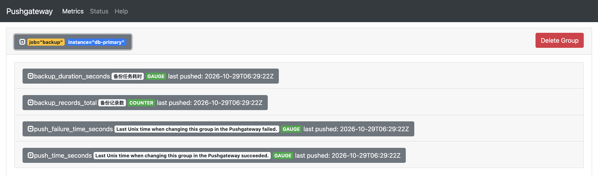
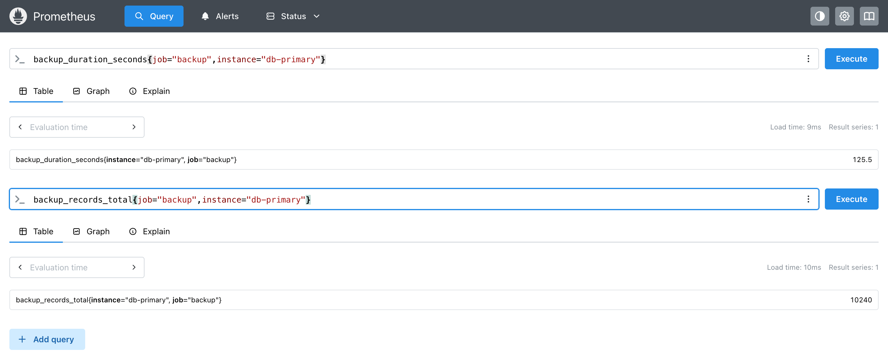

`Pushgateway`是`Prometheus`生态中的一个中间网关组件，用于接收短生命周期任务或批处理脚本主动推送的监控指标。

由于`Prometheus`默认采用`Pull`模式，对于执行完成后立即退出的进程，例如定时`CronJob`任务、备份脚本等，`Prometheus`可能无法及时抓取其指标。`Pushgateway`正是为解决这一场景而设计的，它通过暂存任务主动推送的指标，并向`Prometheus`提供统一的抓取入口，使短生命周期任务即使执行结束，也能在后续抓取周期中被采集到。

使用`Docker`部署是最快捷的方式，适合测试和学习环境。首先，拉取`Pushgateway`镜像：

```sh
docker pull prom/pushgateway:v1.11.4
```

接着，启动容器并将宿主机的`9091`端口映射到容器的`9091`端口：

```bash
docker run -d \
  --name pushgateway \
  -p 9091:9091 \
  -v /opt/pushgateway/data:/data \
  prom/pushgateway:v1.11.4 \
  --persistence.file=/data/metrics.db \
  --persistence.interval=5m
```

`Pushgateway`支持将指标数据持久化到磁盘，主要通过以下两个启动参数进行配置：

1. `--persistence.file=/data/metrics.db`：指定`Pushgateway`指标数据的持久化文件路径，将指标数据保存到磁盘中。容器重启或重新创建后，只要该文件仍然存在，`Pushgateway`就可以在启动时尝试恢复已保存的指标数据。
2. `--persistence.interval=5m`：设置指标数据持久化写入的最小时间间隔为`5`分钟，减少频繁写盘带来的`I/O`开销。间隔越短，数据更新后通常能更快地持久化，但如果进程异常退出，最近一次持久化之后尚未保存的数据仍可能丢失。

启动后，执行以下命令查看容器运行状态：

```bash
docker ps | grep pushgateway
```

如果更倾向于在宿主机上直接运行，可以通过二进制文件部署。

访问`Pushgateway`的`GitHub Releases`页面：https://github.com/prometheus/pushgateway/releases。

在此页面中找到适合你系统架构的最新版本，以`Linux arm64`为例，执行以下命令：

```bash
cd /opt
wget https://github.com/prometheus/pushgateway/releases/download/v1.11.4/pushgateway-1.11.4.linux-arm64.tar.gz
tar -xzf pushgateway-1.11.4.linux-arm64.tar.gz
mv pushgateway-1.11.4.linux-arm64 pushgateway
```

解压并重命名后，执行以下命令启动`Pushgateway`：

```bash
/opt/pushgateway/pushgateway
```

默认监听`9091`端口。启动成功后会输出如下日志：


生产环境中同样建议配置为`Systemd`服务，方法与前文`Node Exporter`的`Systemd`配置类似，此处不再赘述。

无论使用哪种方式安装，都可以通过以下命令验证`Pushgateway`是否正常运行：

```bash
curl http://localhost:9091/metrics
```

如果返回大量以`# TYPE`和`# HELP`开头的文本数据，则说明`Pushgateway`服务运行正常。

`Pushgateway`提供了一个简单的`Web UI`，可以通过浏览器访问`http://<server-ip>:9091`查看当前已推送的所有指标分组。

`Pushgateway`安装完成后，需要在`Prometheus`的配置文件中将其添加为抓取目标。与普通抓取目标不同，配置`Pushgateway`时强烈建议设置`honor_labels: true`，否则`Prometheus`会使用自身的`job`和`instance`标签覆盖推送方原本携带的同名标签。

编辑`prometheus.yml`配置文件：

```
vim /opt/prometheus/config/prometheus.yml
```

在`scrape_configs`配置项中追加以下内容：

```yaml
  - job_name: 'pushgateway'
    honor_labels: true
    static_configs:
      - targets: ['192.168.64.3:9091']
```

其中`192.168.64.3:9091`是部署`Pushgateway`的主机`IP`和端口。同样地，如果希望容器间通过名称通信，也可以创建自定义`bridge`网络，将`Prometheus`和`Pushgateway`接入同一网络，通过容器名进行`DNS`解析。

保存配置后执行热加载：

```bash
curl -X POST http://localhost:9090/-/reload
```

打开`Prometheus`的`Web UI`，进入「`Status`」→「`Target health`」页面，即可找到`Pushgateway`任务：


`Pushgateway`的核心用法是让短生命周期任务主动推送指标。推送通过标准的`HTTP POST`请求完成，数据格式与`Prometheus`的文本暴露格式一致。以下是使用`curl`推送指标的一个完整示例：

```bash
cat <<EOF | curl --data-binary @- http://localhost:9091/metrics/job/backup/instance/db-primary
# HELP backup_duration_seconds 备份任务耗时
# TYPE backup_duration_seconds gauge
backup_duration_seconds 125.5
# HELP backup_records_total 备份记录数
# TYPE backup_records_total counter
backup_records_total 10240
EOF
```

上述命令的核心作用是将备份任务的指标推送到`Pushgateway`，供`Prometheus`后续采集。

推送完成后，访问`Pushgateway`的`Web UI`，即可查看对应的分组及其中的两条指标信息：



除被推送的两条指标外，`Pushgateway`还会自动为该分组附加以下两个内置指标：

- `push_time_seconds`：记录该分组最后一次成功推送的`Unix`时间戳，可用于判断定时任务是否漏执行。

- `push_failure_time_seconds`：记录该分组最后一次推送失败的时间戳。

`http://localhost:9091/metrics/job/backup/instance/db-primary`是推送指标的`URL`路径。`Pushgateway`官方定义的路径格式为`/metrics/job/<JOB_NAME>{/<LABEL_NAME>/<LABEL_VALUE>}`。其中，`job`是必填的固定路径段，`<JOB_NAME>`表示任务名称，后续可以追加任意数量的标签名与标签值，且每个附加标签都必须按照「标签名/标签值」的形式成对出现。

因此，该示例中的`job/backup`用于标识任务类型，`instance/db-primary`用于标识任务实例，两者共同确定指标所属的分组。执行推送后，`Pushgateway`会为该分组下的指标添加`job="backup"`和`instance="db-primary"`两个标签。

`--data-binary @-`表示从标准输入读取数据，并将其作为请求正文发送。结合管道和多行输入语法，可以直接推送多行指标文本，无须创建临时文件。请求正文遵循`Prometheus`的文本暴露格式，包含`HELP`指标说明、`TYPE`指标类型声明及具体指标值。

该命令默认使用`HTTP POST`方法。向同一个分组推送指标时，`Pushgateway`会用新值覆盖同名指标的旧值，但不会自动删除本次请求中未出现的其他指标；如果需要完整替换该分组中的全部指标，可以使用`HTTP PUT`方法。因此，每次备份任务完成后，都可以向相同的`job/instance`分组推送最新的任务耗时和记录数，以更新指标值。

等待`Prometheus`完成一次抓取周期（默认`15`秒）后，打开`Prometheus`的`Web UI`，输入以下`PromQL`即可查看对应指标：

```promql
backup_duration_seconds{job="backup",instance="db-primary"}
backup_records_total{job="backup",instance="db-primary"}
```

查询到的结果如下所示：



任务结束后，可以通过以下命令清理已推送的指标：

```bash
curl -X DELETE http://localhost:9091/metrics/job/backup/instance/db-primary
```
