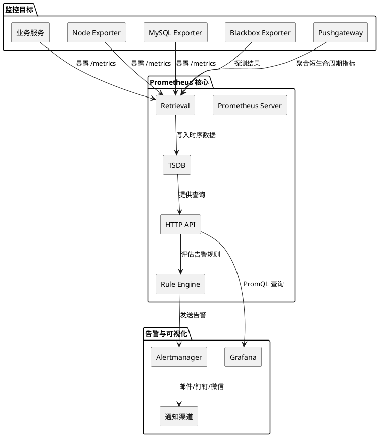

`Prometheus`（普罗米修斯）是一套开源的监控与告警系统，由`SoundCloud`公司于`2012`年发起开发，并于`2016`年加入`CNCF`（云原生计算基金会），成为继`Kubernetes`之后第二个毕业项目。它本质上是一个时序数据库（`Time Series Database`，简称`TSDB`），主要用于存储和查询带有时间戳的指标数据。

`Prometheus`采用`Pull`模型采集数据，由`Prometheus Server`主动从被监控目标拉取指标，而非等待目标推送数据。它支持多维数据模型，通过指标名称和一组键值对标签（`Label`）标识指标，便于灵活地进行数据过滤与聚合。

`Prometheus`采用单机架构设计，本身不提供原生的分布式集群方案，其高可用性和水平扩展通常依赖联邦集群（`Federation`）或`Thanos`、`Cortex`等第三方解决方案。此外，`Prometheus`内置了强大的告警规则引擎和查询语言`PromQL`，能够直接在服务端执行复杂的指标查询、数据计算与告警评估。

`Prometheus`生态由多个组件构成，各自承担不同的职责，下面进行逐一讲解。

### 1. `Prometheus Server`

`Prometheus Server`是整个监控系统的核心，内部主要包含三个模块，分别负责指标抓取、时序数据存储和查询接口服务：

- `Retrieval`（抓取模块）根据配置文件中的`scrape_configs`配置项，定时向被监控目标发起`HTTP`请求，采集指标数据。默认抓取间隔为`1`分钟，可通过`scrape_interval`配置项进行调整。

- `TSDB`（时序数据库模块）负责将采集到的样本数据写入本地磁盘。`Prometheus`采用自定义的时序数据存储格式，并通过数据压缩机制降低存储开销。默认数据保留时间为`15`天，可通过启动参数`--storage.tsdb.retention.time`进行调整。

- `HTTP API`（查询接口模块）负责对外提供`HTTP`接口，支持`PromQL`查询及相关管理操作，同时允许`Grafana`等外部系统调用，实现指标数据的查询、分析与可视化。

### 2. `Exporters`

`Exporter`是一类指标采集代理程序，用于将非`Prometheus`原生格式的监控数据转换为`Prometheus`可识别的指标格式，并通过`HTTP`接口暴露指标，供`Prometheus`定期抓取。

`Prometheus`社区维护了大量官方及第三方`Exporter`，用于监控操作系统、网络服务和各类中间件：

`Node Exporter`主要面向类`Unix`系统，包括`Linux`、`Darwin`和`FreeBSD`等，负责暴露`CPU`、内存、磁盘、`IO`和网络等系统级指标。对于`Windows`平台，则需要使用专门的`Windows Exporter`，其前身为`wmi_exporter`。

`Blackbox Exporter`通过`HTTP`、`HTTPS`、`TCP`和`ICMP`等协议主动探测目标，用于检测服务的可达性、响应时间及证书有效期等信息，常用于监控网站、接口和网络服务的可用性。

`MySQL Exporter`、`Redis Exporter`和`Nginx Exporter`分别用于采集对应中间件的运行指标，例如`MySQL`的连接数与查询性能、`Redis`的内存使用量与缓存命中率，以及`Nginx`的请求处理情况与连接状态等，帮助开发人员分析中间件的运行状况和性能表现。

### 3. `Alertmanager`

`Alertmanager`负责接收`Prometheus Server`触发的告警，并进行去重、分组、路由和静默处理，最终通过邮件、钉钉、企业微信、`Slack`、`PagerDuty`等渠道发送通知。其核心能力包括：

- 告警分组（`Group`）：将具有相同特征的告警合并为一条通知，减少重复通知，避免告警风暴。
- 告警抑制（`Inhibition`）：当高优先级告警触发时，根据预设规则抑制相关的低优先级告警，避免产生冗余通知。
- 告警静默（`Silences`）：在维护窗口期间，根据匹配条件临时停止特定告警的通知发送。
- 告警路由（`Routing`）：根据告警标签和路由规则，将告警通知分发到不同的接收组或通知渠道。

### 4. `Pushgateway`

`Pushgateway`是一种中间网关，用于接收短期任务或批处理任务主动推送的指标。由于`Prometheus`采用`Pull`模型，对于生命周期极短的作业（如定时`CronJob`），`Prometheus`可能来不及抓取指标。此时，可以由作业将指标推送到`Pushgateway`，再由`Prometheus`从`Pushgateway`中拉取相关指标。

需要注意的是，`Pushgateway`中的指标默认不会自动过期清除。如果推送方没有主动清理，旧数据会一直保留，导致监控数据失真。因此，生产环境中应谨慎使用，并在任务结束后主动调用`DELETE`接口清理指标，或借助外部定时脚本实现过期清理。`Pushgateway`本身没有原生的自动`TTL`机制，但`v1.6+`版本提供了实验性的`--metric.timetolive`参数。

### 2. 整体架构图

`Prometheus`的整体数据流与各组件之间的关系可以用如下`PlantUML`图表示：

从图中可以看出，整个监控系统的数据流向如下：

1. 各类`Exporter`和业务服务通过`HTTP`暴露指标端点。
2. `Prometheus Server`中的`Retrieval`模块定时拉取这些指标，写入`TSDB`。
3. `HTTP API`层对外提供查询能力，`Grafana`通过`PromQL`查询数据进行可视化展示。
4. 告警规则引擎定期评估存储的数据，当条件满足时向`Alertmanager`发送告警。
5. `Alertmanager`对告警进行处理后，通过配置的渠道通知运维人员。

### 3. 适用场景与局限

`Prometheus`非常适合以下场景：

- 云原生环境下的容器和微服务监控，特别是`Kubernetes`集群。
- 需要灵活的多维查询和聚合分析的场景。
- 对实时性要求较高的监控和告警场景。

但`Prometheus`也存在一些局限，在某些场景下需要谨慎选型：

- 不适合需要`100%`数据精确性的计费场景，因为`Pull`模型可能因网络波动导致采样缺失。
- 默认仅支持本地存储，单节点容量和查询性能存在上限，超大规模场景需要配合`Thanos`、`VictoriaMetrics`等方案进行扩展。
- 对于日志和分布式追踪的支持较弱，通常需要配合`ELK`、`Loki`、`Jaeger`等工具构成完整的可观测性体系。
