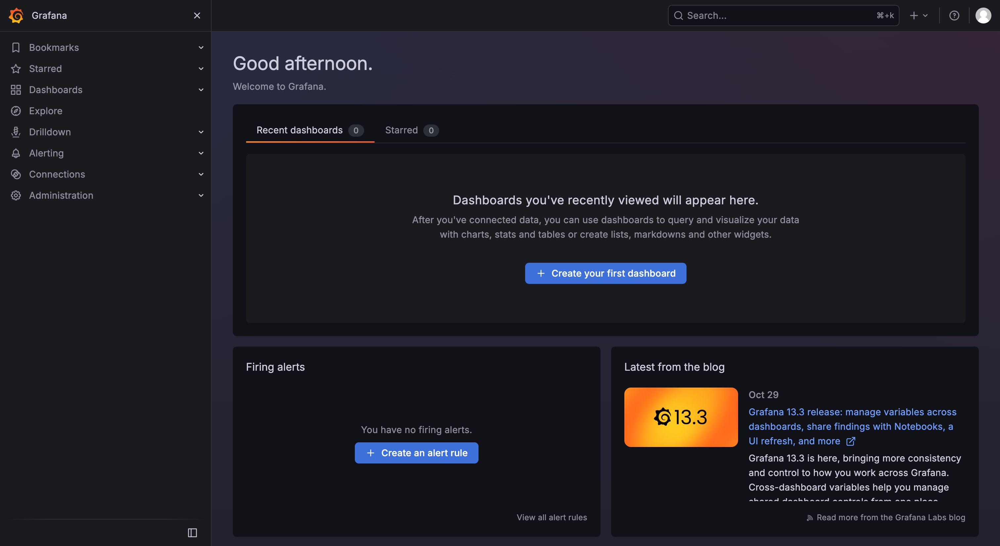
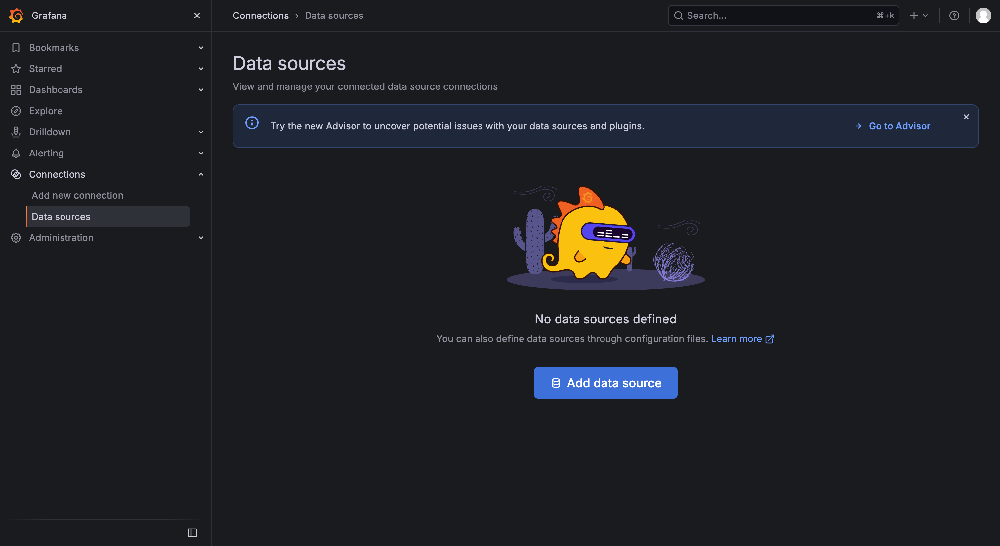
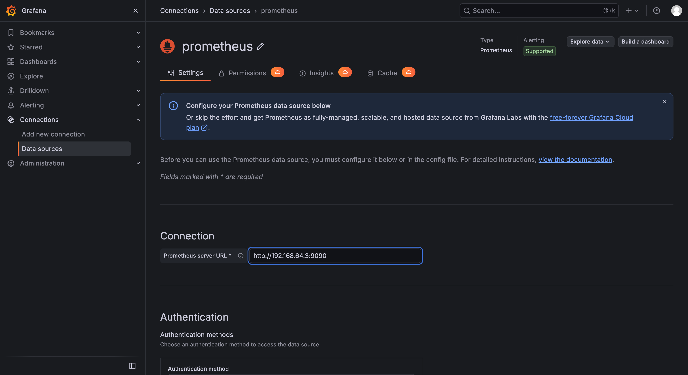
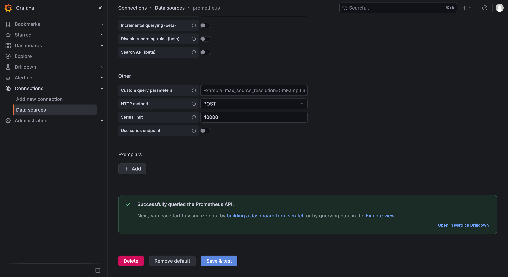
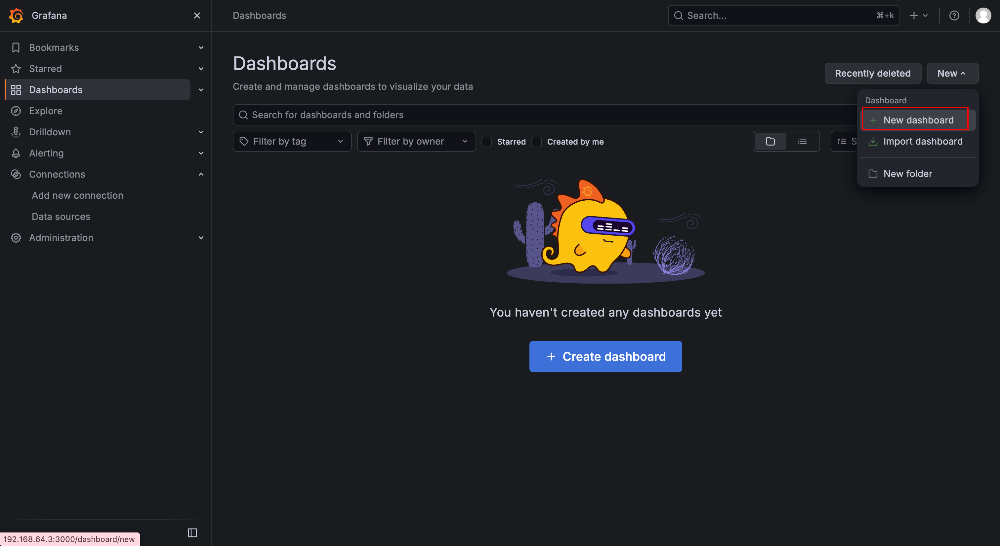
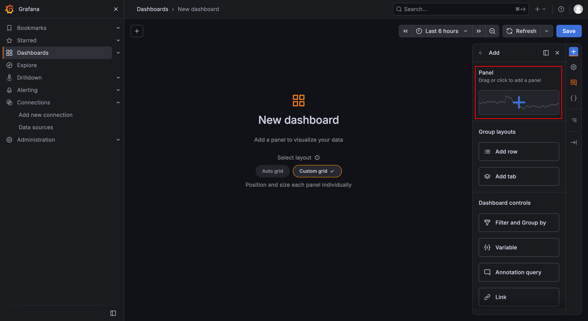
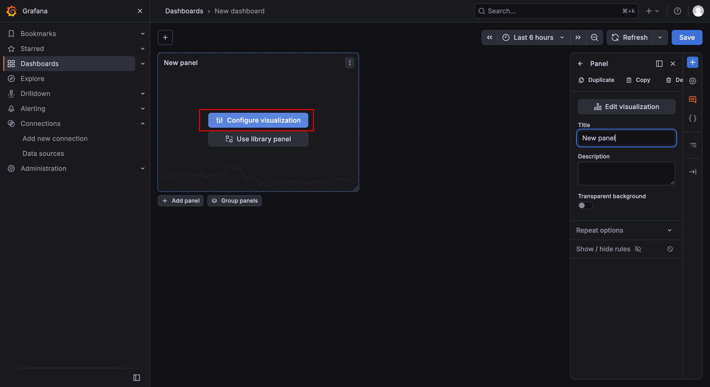
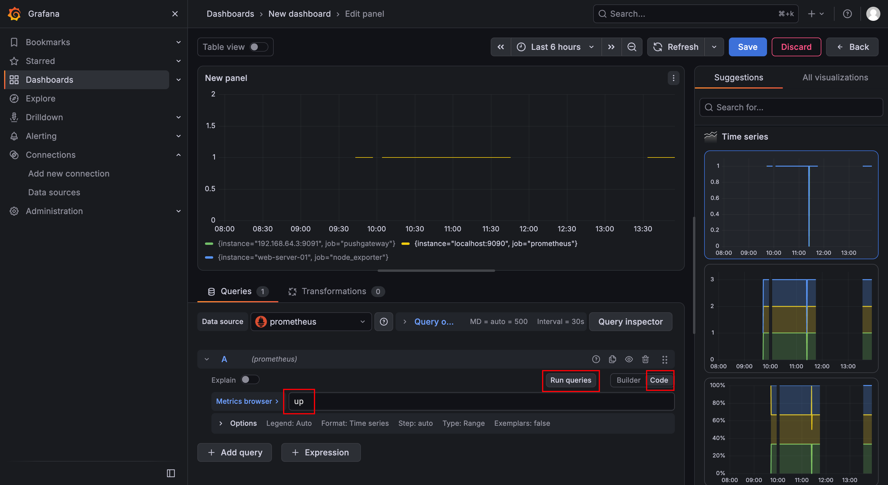
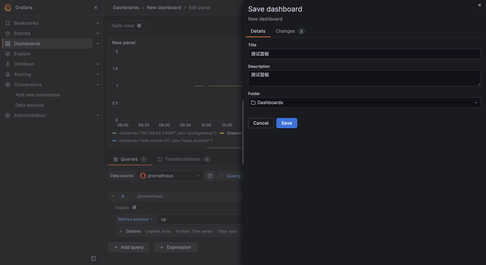
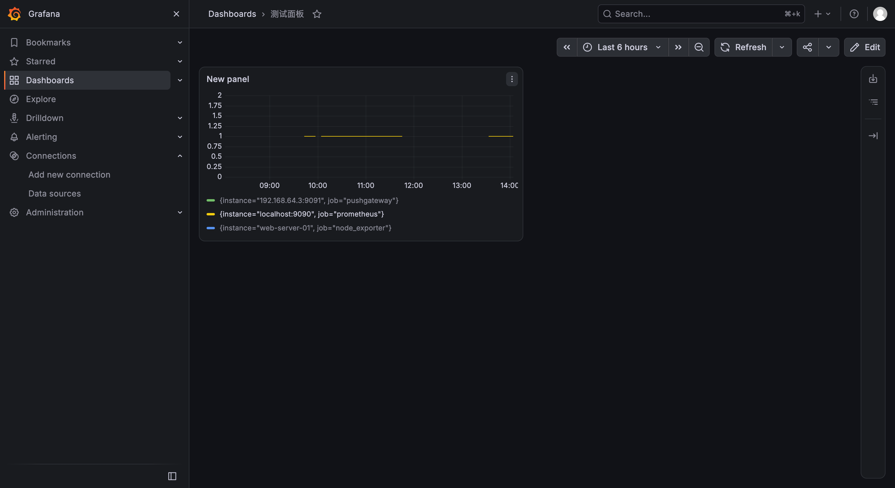

本文介绍如何通过`Docker`快速部署`Grafana`服务，并将其与`Prometheus`数据源进行对接，实现监控数据的可视化展示。

`Grafana`是一款开源的数据可视化与监控分析平台，支持接入`Prometheus`、`Elasticsearch`、`InfluxDB`等多种数据源，并通过丰富的图表面板，将监控指标以直观、易于理解的方式呈现出来。

首先，在宿主机上创建配置目录和数据目录，用于持久化存储`Grafana`的配置文件和数据库数据：

```bash
mkdir -p /opt/grafana/config
mkdir -p /opt/grafana/data
```

创建完成后，建议为`data`目录赋予`777`权限，避免容器内用户因权限不足而无法写入数据：

```bash
chmod 777 /opt/grafana/data
```

使用以下命令拉取最新版本的`Grafana`镜像：

```sh
docker pull grafana/grafana:13.2.0
```

创建并启动`Grafana`容器：

```bash
docker run -d \
  --name grafana \
  -p 3000:3000 \
  -v /opt/grafana/data:/var/lib/grafana \
  -e GF_SECURITY_ADMIN_PASSWORD=admin123 \
  grafana/grafana:13.2.0
```

`-e GF_SECURITY_ADMIN_PASSWORD=admin123`表示通过环境变量预先设置`Grafana`管理员账号`admin`的登录密码为`admin123`。若省略该变量，`Grafana`首次启动时默认使用`admin`作为初始密码，并在首次登录时强制要求修改密码。

执行上述命令后，可以通过以下命令查看容器状态：

```bash
docker ps | grep grafana
```

打开浏览器，访问`http://<server-ip>:3000`。如果能正常显示`Grafana`登录页面，则说明安装成功：


在登录页面输入用户名`admin`和密码`admin123`，即可进入`Grafana`主页：



`Grafana`部署完成后，需要添加`Prometheus`作为数据源，才能实现监控数据的可视化展示。点击页面左侧的「`Connections`」→「`Data sources`」，然后点击「`Add data source`」按钮：



在数据源类型列表中选择「`Prometheus`」，进入`Prometheus`数据源配置页面后，在「`Connection`」区域的「`Prometheus server URL`」输入框中填入`Prometheus`的访问地址，例如`http://192.168.64.3:9090`：



配置完成后，滚动至页面底部，点击「`Save & test`」按钮。若配置正确，页面将显示绿色成功提示：



数据源添加成功后，即可创建仪表盘，用于可视化展示`Prometheus`采集的监控指标。点击页面左侧的「`Dashboards`」，然后依次选择「`New`」→「`New dashboard`」：



点击右侧「`Panel`」区域中显示「`Drag or click to add a panel`」文字及折线图图标的图表卡片：



点击中间的「`Configure visualization`」蓝色按钮，进入面板的数据查询配置界面：



数据源已自动选中`Prometheus`，接下来需要切换到代码模式输入`PromQL`。点击查询区域右上角的「`Code`」按钮：



切换后会出现一个文本输入框，在其中输入`up`，然后点击旁边的「`Run queries`」按钮，即可查看监控图表。如果`Prometheus`正常采集了监控目标，图表将显示几条值为`1`的横线，表示各监控目标均处于在线状态。

接着，点击屏幕右上角的「`Save`」按钮，即可保存该面板：



后续再次进入「`Dashboards`」，即可查看该面板的相关信息：



`Grafana`支持通过挂载自定义的`grafana.ini`配置文件，实现更细粒度的配置管理。由于直接挂载一个空白文件会覆盖容器内原有的默认配置，导致服务启动异常，建议先从容器的默认配置中复制一份出来作为模板：

```sh
docker cp grafana:/etc/grafana/grafana.ini /opt/grafana/config/grafana.ini
```

然后在宿主机上基于该模板进行编辑修改：

```sh
vim /opt/grafana/config/grafana.ini
```

配置文件编辑完成后，需要先停止并删除旧容器，再根据新的启动命令重新创建容器：

```sh
docker stop grafana
docker rm grafana
```

重新创建容器时，在启动命令中追加挂载参数：

```sh
  -v /opt/grafana/config/grafana.ini:/etc/grafana/grafana.ini \
```

即可将宿主机的自定义配置文件挂载至容器，并使配置生效。

需要注意的是，当环境变量与配置文件中存在同名配置项时，环境变量的优先级高于配置文件。
