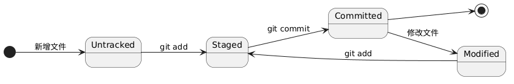
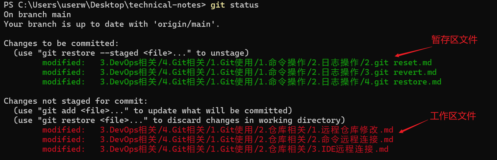

在讲解`git restore`命令之前，首先要理解下面这几个关键概念：

1. 工作区：任何对项目文件的修改都会直接反映在工作区中，它展示了计算机上实际的项目文件的变动。
2. 暂存区：又称为索引，是一个临时存储区域。通过使用`git add`命令，可以将指定的文件从工作区添加到暂存区。暂存区的存在使得用户能够灵活选择哪些更改应包含在下次提交（`commit`）中。
3. 本地仓库：存储在本地计算机上的完整项目版本库，包含项目的所有历史版本。每次使用`git commit`命令时，暂存区的内容会被提交到本地仓库中。用户可以通过`git log`命令查看本地仓库的提交历史。
4. 远程仓库：存储在服务器上的版本库，通常用于团队协作。用户可以将本地仓库的提交推送（`git push`）到远程仓库，也可以从远程仓库拉取（`git pull`）提交，并合并到本地仓库。常见的远程仓库托管服务包括`GitHub`、`GitLab`和`Gitee`等。

此外，还需要了解`Git`中文件的生命周期状态：

- `Untracked`（未跟踪）：新创建的文件默认处于此状态，`Git`尚未对其进行版本跟踪。
- `Unmodified`（未修改）：文件已被`Git`跟踪，且工作区中的内容与版本库中的内容保持一致。
- `Modified`（已修改）：已被`Git`跟踪的文件在工作区中发生了修改。
- `Staged`（已暂存）：通过`git add`将文件的添加或修改添加到暂存区，等待下一次提交。
- `Committed`（已提交）：通过`git commit`将暂存区中的内容提交到本地仓库。

各状态流转图如下所示：



理解了上述状态后，便能更清晰地认识各个命令的作用范围。

我们想回退所有在工作区的文件（也就是撤销文件修改）时，可以使用以下命令：

```sh
git restore .            # 撤销所有修改
git restore <file_name>  # 撤销指定文件修改（支持多选）
```

需要注意，`git restore`命令只能作用于已被`Git`跟踪的文件，它会将这些文件恢复到当前`HEAD`中的版本，也就是回退其修改。而对于新增但尚未被`Git`跟踪的文件，`git restore`并不会处理，也就是不会删除这些新增文件。

如果工作区中存在未被`Git`跟踪的新增文件，需要清理这些文件时，可以使用`git clean`命令。

首先预览即将被删除的内容，避免误删：

```
git clean -nd
```

其中`-n`表示预览模式，仅列出即将被删除的文件和目录，不会实际执行删除。`-d`表示同时包含未被跟踪的目录。

确认预览结果无误后，再执行实际删除操作：

```
git clean -fd
```

其中`-f`表示强制执行删除操作，与`-d`配合使用时，可以递归删除未被跟踪的目录及其文件。

需要注意的是，`git clean`仅会删除`Untracked`状态的文件和目录，不会影响已被`Git`跟踪的文件及其修改内容。

如果我们想把在暂存区的文件回退到工作区，可以使用以下命令：

```sh
git restore --staged .            # 撤销暂存区的所有文件
git restore --staged <file_name>  # 撤销暂存区指定文件（支持多选）
```

如果一个文件已经被`add`到暂存区，但又突然不打算提交，并希望将其加入`.gitignore`，需要先将该文件从暂存区回退到工作区，然后再把它写入`.gitignore`，否则忽略规则不会生效。

如果想直接一步到位，回退所有工作区、暂存区的文件，可以使用以下命令：

```sh
git reset --hard HEAD
```

我们可以使用下面的命令查看项目已修改文件在`Git`的哪个区域：

```sh
git status
```

展示的结果如下所示：



如果一个文件已经提交到本地或远程仓库，想从仓库中删除该文件，但要保留本地文件，可以使用以下命令：

```sh
git rm --cached <file_name>
```

如果要删除的是目录，需要添加`-r`参数以启用递归删除：

```sh
git rm -r --cached <dir_name>
```

执行该命令通常是为了在`Git`中移除本应被`.gitignore`忽略的文件或目录。但由于这些文件或目录已经提交到仓库，必须先将其从仓库中删除，再将其写入`.gitignore`。这样可以确保它们在后续不再被版本控制，同时仍然保留在本地。
