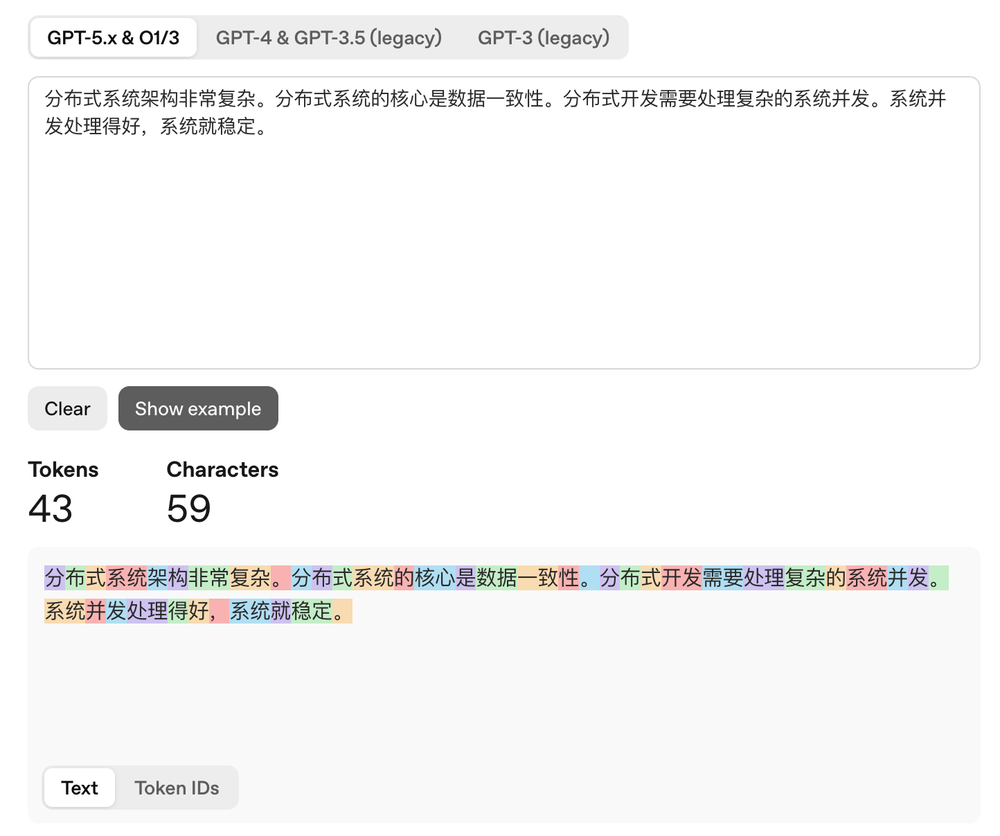
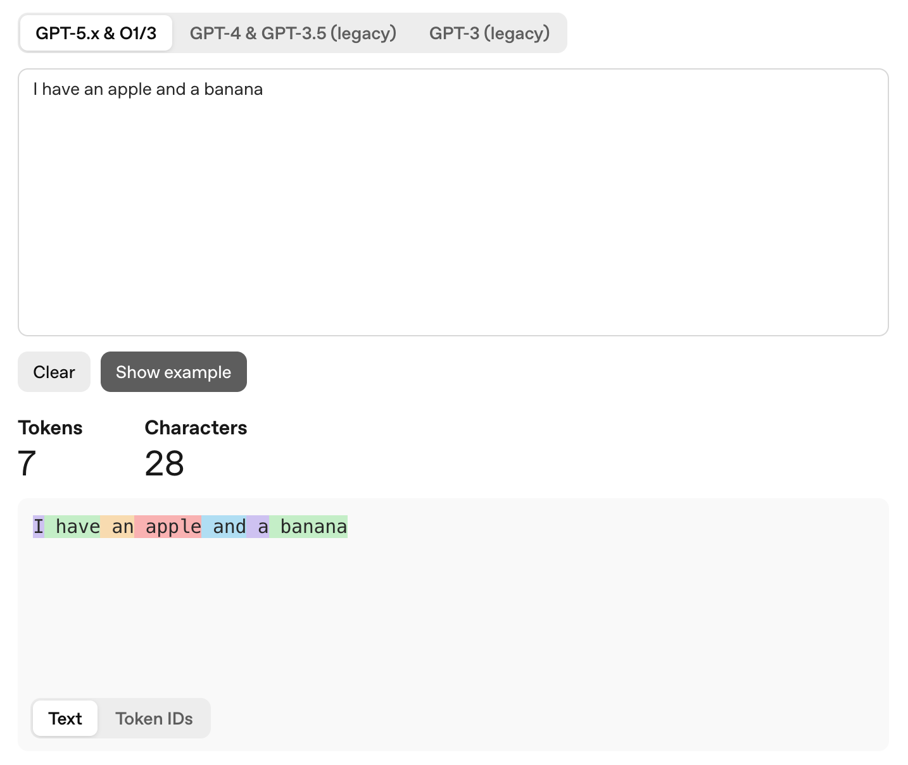
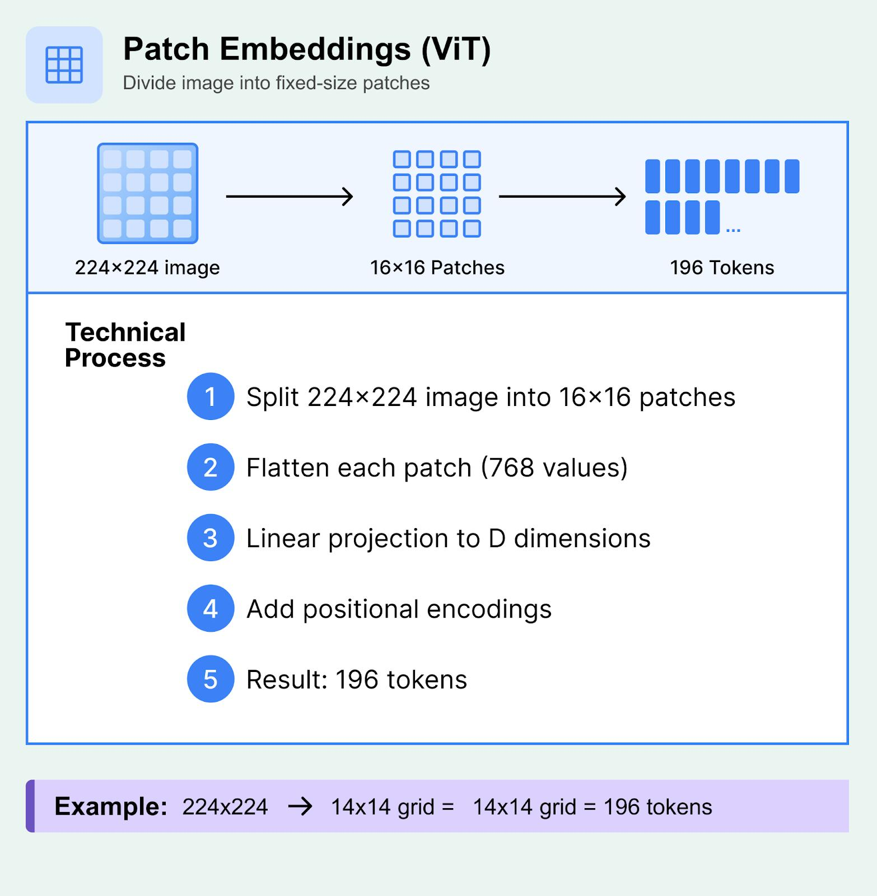

在`LLM`领域中，`Token`是模型能够理解和处理的最小文本单元。人类可以直接理解自然语言，而大模型本身并不具备这种能力，因此需要一个翻译官将自然语言转换为模型可处理的表示，这个翻译官称为`Tokenizer`，学名为分词器。

首先，`Tokenizer`需要构建词表，并为其中的每一个`Token`分配唯一的整数标识，即`TokenID`。这一过程称为预训练分词，由分词器`Tokenizer`内部的训练器`Trainer`模块负责完成，一旦训练开始，这一对应关系便保持不变。该映射关系通常会被保存为一个配置文件，通常为`.json`或`.txt`格式，名称为`tokenlizer.json`。

预训练语料（`Pre-training Corpus`）的来源极为广泛，本质上涵盖了人类在互联网上留下的几乎所有公开文本数据，包括通用网页抓取、代码数据、书籍与学术文献、社交媒体与对话，以及各类垂直领域和多语言数据等。

在数据进入`Tokenizer`之前，必须经过严格的数据清洗流程，包括去重（`De-duplication`），用于剔除大量重复内容，避免模型对重复数据过拟合而产生「复读」现象；过滤（`Filtering`），用于移除低质量内容（如垃圾广告、乱码）以及有害内容（如色情、暴力、极端偏见）；以及语言识别，用于确保输入数据符合预期语种。

对于中文而言，每个字都可以作为一个`Token`。但如果仅采用这种方式，一句话对应的`Token`数量会非常多，也就是转换为`TokenID`数组后长度过长。因此，`Tokenizer`通常会将高频共现的字组合在一起，生成新的`Token`，分配新的`TokenID`。

例如存在这样一段预训练语料：

```sh
分布式系统架构非常复杂。分布式系统的核心是数据一致性。分布式开发需要处理复杂的系统并发。系统并发处理得好，系统就稳定。
```

首先，语料中的每个字都会被映射为对应的`TokenID`进行记录，随后算法通过统计分析高频共现关系，发现「分、布、式」、「系、统」、「并、发」等字组合经常一起出现，因此会将这些连续且高频的字进行合并，形成更长的`Token`。

例如将`[分]`、`[布]`、`[式]`合并为`[分布式]`，将`[系]`、`[统]`合并为`[系统]`，以及将`[并]`、`[发]`合并为`[并发]`，从而在保证语义表达能力的同时，有效减少`Token`数量并提升编码效率。此时文本分词后的结果为：

```sh
[分布式] [系统] [架构] [非常] [复杂] [。] [分布式] [系统] [的] [核心] [是] [数据] [一致] [性] [。] [分布式] [开发] [需要] [处理] [复杂] [的] [系统] [并发] [。] [系统] [并发] [处理] [得] [好] [，] [系统] [就] [稳定] [。]
```

接下来可以进行更高阶的压缩，即在词组层面继续合并。当基础词已经足够稳定时，算法会尝试将它们连接起来，形成更长的专业`Token`。例如，将`[分布式]`与`[系统]`组合为`[分布式系统]`，将`[系统]`与`[并发]`组合为`[系统并发]`：

```sh
[分布式系统] [架构] [非常] [复杂] [。] [分布式系统] [的] [核心] [是] [数据] [一致] [性] [。] [分布式] [开发] [需要] [处理] [复杂] [的] [系统并发] [。] [系统并发] [处理] [得] [好] [，] [系统] [就] [稳定] [。]
```

这样一来，`Tokenizer`将原本每个字符都单独作为一个`Token`时所需的`59`个`Token`，压缩到了`30`个。需要说明的是，这里仅用于演示`Token`分词的基本原理；在实际应用中，由于语料规模极大，只有极高频的词才会被合并为一个`Token`。因此，上述这段话在真实环境中的`Token`数量通常不会低至`30`个，可以通过相关网站查看其实际的`Token`统计结果：



> `OpenAI`官方提供的文本转`Token`工具地址：https://platform.openai.com/tokenizer。

文本分词本质上是一种离散化过程，即将自然语言文本切分为一系列`Token`，再通过查询预训练分词表，将每个`Token`转换为对应的`TokenID`，从而形成一个`TokenID`序列。随后，模型通过`Embedding`层，将序列中的每个`TokenID`映射为固定维度的连续向量，最终得到由多个向量组成的向量序列，供`Transformer`进行后续计算。

假设输入文本为「我喜欢学习」，经过分词后得到`3`个`Token`，其对应的`TokenID`如下所示：

```go
tokenIDs := []int{101, 205, 306}
```

每个`TokenID`经过`Embedding`层后，映射为一个`4`维向量：

```scss
Token1（我）
TokenID: 101
Embedding: [0.2, 0.5, -0.1, 0.8]

Token2（喜欢）
TokenID: 205
Embedding: [0.3, -0.2, 0.7, 0.1]

Token3（学习）
TokenID: 306
Embedding: [-0.4, 0.6, 0.2, 0.9]
```

将这`3`个四维向量按顺序排列，就得到一个`3 × 4`的矩阵：

```scss
X = [ 0.2   0.5  -0.1   0.8
      0.3  -0.2   0.7   0.1
     -0.4   0.6   0.2   0.9 ]
```

其中，`3`表示输入序列包含`3`个`Token`，`4`表示每个`Token`对应一个四维向量。在主流大语言模型中，每个`Token`经过`Embedding`层后，通常会被映射为几百到上万维的向量，常见维度范围为`768～16384`维。

一个`Token`并不一定对应至少一个汉字。在实际分词过程中，如果遇到生僻字或不常用字，这些字符可能会被拆分为多个`Token`，通常为`2`到`3`个不等。这是因为分词算法更倾向于基于已有的高频子结构进行编码，而不是为低频字符单独分配完整的`Token`。

对于英文分词，通常只有高频词汇才会被划分为一个完整的`Token`，其余词汇一般会被拆分为子词。像`the`、`apple`、`run`这类在语料库中出现频率极高的词，算法会为其分配独立的`TokenID`，使其在模型中作为不可再分的语义单元存在。对于低频词或较长的词，模型则会将其拆解为更小的片段（类似词根、前缀、后缀）。例如`misunderstanding`会被拆分为`mis` + `under` + `standing`。

需要注意的是，在大多数现代大语言模型使用的分词技术中，空格通常会被视为紧随其后的单词的一部分。例如：



如果将空格单独作为一个`Token`处理，会显著增加文本的`Token`数量（在极端情况下甚至接近翻倍），从而占用更多的上下文窗口并提升计算成本。将空格附着在单词开头的做法，可以在减少`Token`数量的同时，更贴近人类语言的自然书写结构。

一般来说，`1000`个`Token`大致对应`3800-4200`个英文字符，或约`750`个英文单词；对于中文，则大约相当于`1600–1800`个汉字。

如果将所有词语或短句都直接作为一个独立的`Token`，词表规模会迅速膨胀；同时，一旦模型遇到未收录的新词，就难以进行有效处理。此外，这种方式也会削弱模型对拼写错误的鲁棒性，使其难以识别和纠正用户输入中的错误。

不同大模型的分词器与词表设计各自独立，没有统一的通用`TokenID`编码，同一句话在不同模型中对应的`TokenID`序列完全不同。

当前，大模型的发展正朝着多模态（`Multimodal`）方向不断演进。传统语言模型主要处理文本数据，而多模态大模型能够同时处理文本、图像、音频，甚至视频等不同类型的数据。对于文本数据，`Tokenizer`会将自然语言切分为一个个`Token`，再通过词表将其映射为对应的`TokenID`。然而，图像和音频等数据并非由文本构成，无法直接沿用传统的文本分词方式进行处理。

下面以图像为例，介绍如何将非文本数据划分为模型能够处理的基本单元。

图像本质上是由大量像素构成的二维数据。每个像素通常包含多个颜色通道，例如`RGB`图像包含红、绿、蓝三个颜色通道，每个通道记录对应位置的颜色强度。假设存在一张分辨率为`224 × 224`的`RGB`图像，那么它包含的像素数量为`224 × 224 = 50176`。由于每个像素包含`3`个颜色通道，因此整张图片共包含`224 × 224 × 3 = 150528`个颜色数值。

如果直接将整张图片展平为一个长数组，得到的数据长度将达到`150528`，不仅难以保留图像的局部空间结构，也会增加后续模型处理原始数据的负担。如果将整张图片直接压缩为一个向量，又可能丢失大量局部细节，例如物体的位置、边缘、纹理以及不同物体之间的空间关系。因此，图像模型通常会先将图片划分为多个较小的区域，再分别对这些区域进行编码。

在以`Vision Transformer`（`ViT`）为代表的视觉模型中，常见的做法是将图像划分为多个固定大小的小块，这些小块称为`Patch`。例如，一张分辨率为`224 × 224`的图片，可以按照`16 × 16`像素的大小进行切分：



由于图片的宽度和高度均为`224`，每个`Patch`的宽度和高度均为`16`，因此每个方向可以划分为`224 ÷ 16 = 14`个`Patch`。最终得到的`Patch`总数为`14 × 14 = 196`，也就是说，原本的一张图片被划分为`196`个局部区域。

完成图像切分后，每个`Patch`仍然由一组像素数值构成，无法直接作为标准`Transformer`的输入，因此需要通过向量化操作，将其映射到固定维度的连续向量空间。每个`Patch`的大小为`16 × 16`，且包含`3`个颜色通道，因此单个`Patch`包含`16 × 16 × 3 = 768`个数值。将这些数值展平后，即可得到一个长度为`768`的一维向量。随后，模型通过线性投影层，将该向量映射到指定的隐藏维度。例如，若模型的隐藏维度为`1024`，则每个`Patch`会被映射为一个`1024`维的连续向量。

经过这一处理，原始像素数据便转换为模型能够进一步处理的视觉特征表示。

将图像切分为多个`Patch`并转换为向量后，模型仍然缺少各个局部区域的位置信息。例如，两个视觉特征相同的`Patch`，分别位于图片的左上角和右下角，其空间含义可能不同。因此，经典`ViT`通过位置嵌入（`Position Embedding`）为每个视觉向量添加位置信息，将视觉特征与对应的位置向量相加，得到融合位置信息后的向量。

完成位置嵌入后，所有视觉向量按照既定顺序排列，形成向量序列，并输入`Transformer`进行后续计算。
