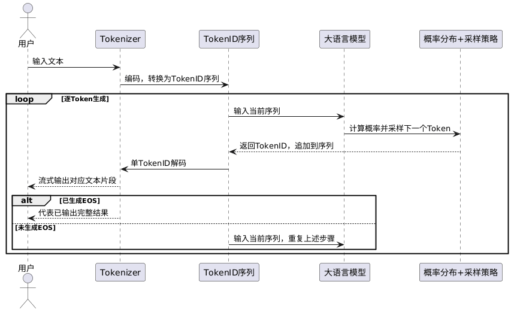

在「`Token`概念」一节中提到，大模型并不会直接处理用户输入的自然语言文本，而是先通过`Tokenizer`将文本切分为多个`Token`，再根据预训练分词词表将其映射为`TokenID`序列。随后，每个`TokenID`会经过`Embedding`层映射为高维向量，并通过位置编码机制，如`RoPE`旋转位置编码，形成同时包含语义信息与顺序信息的高维向量序列，作为模型计算的输入。

在上一节中我们讲到，神经网络本质上是由大量可学习参数定义的高维非线性函数，并以线性函数`y = ax + b`作为辅助理解。放到实际的神经网络中，可以将这种计算从单个神经元扩展到整层网络。由于同一层通常包含大量神经元，它们会同时对输入进行计算，因此可以将多个输入组合成一个向量`x`，将所有神经元的权重组合成一个矩阵`W`，将偏置组合成一个向量`b`。这样，整层网络的计算就可以统一表示为`y = Wx + b`。其中，`W`负责对输入进行线性变换，`b`负责对变换结果进行偏移，最终得到新的输出向量`y`。

当输入包含多个`Token`时，每个`Token`都可以表示为一个向量，这些向量组合后形成矩阵`X`，也可以将其理解为一个高维向量序列。此时，线性变换通常表示为`Y = XWᵀ + b`。其中，`X`的每一行表示一个`Token`对应的向量，`Wᵀ`对每个`Token`执行相同的线性变换，`b`则通过广播机制加到每个`Token`的输出向量上，最终得到输出矩阵`Y`。

这里的算式具体写法取决于向量的表示方式。数学中通常将向量表示为列向量，`Token`表示为矩阵`X`中的一列，因此线性变换可以写成`Y = WX + b`。而在实际编程中，通常将每个`Token`表示为矩阵`X`中的一行，即采用行向量表示。为满足矩阵乘法的维度要求，需要将权重矩阵`W`进行转置，因此最终写成`Y = XWᵀ + b`。

在`LLM`中，对于保持`Token`向量维度不变的线性变换，`W`通常是一个方阵，其行数和列数均与每个`Token`对应的向量维度一致。例如，当每个`Token`表示为`4096`维向量时，`W`就是一个`4096 × 4096`的方阵。

假设输入有`4`个`Token`，每个`Token`经过`Embedding`后得到一个`3`维向量：

```scss
Token1 → x1 = [x11, x12, x13]
Token2 → x2 = [x21, x22, x23]
Token3 → x3 = [x31, x32, x33]
Token4 → x4 = [x41, x42, x43]
```

把这`4`个向量排列起来，就是一个`4 × 3`矩阵：

```scss
X = [ x11  x12  x13
      x21  x22  x23
      x31  x32  x33
      x41  x42  x43 ]
```

经过`Y = XWᵀ + b`计算后，输出仍然由`4`个向量组成，其维度和序列长度与输入保持一致。这一输出矩阵记作隐状态矩阵`H`：

```scss
H = [ h11  h12  h13
      h21  h22  h23
      h31  h32  h33
      h41  h42  h43 ]
```

`Transformer`最终输出的隐状态矩阵`H`中，每一行分别对应输入序列中相应`Token`融合上下文后的隐层向量：第一行是`Token1`的隐层向量`h1`，第二行是`Token2`的隐层向量`h2`，第三行是`Token3`的隐层向量`h3`，第四行是`Token4`的隐层向量`h4`。在因果注意力机制下，`h1`只能获取`Token1`的信息，无法感知后续`Token`；`h2`只能覆盖`Token1`和`Token2`的信息；`h3`只能覆盖前`3`个`Token`的信息；只有`h4`能够整合全部上文`Token`的信息，形成完整的上下文语义表示。

随后，隐层向量`h4`会经过输出层（`LM-Head`）映射到整个词表空间，得到词表中每个`Token`对应的预测得分（`Logits`）。在采用权重共享（`Weight Tying`）的模型中，这一计算可以理解为与词表中所有`Token`对应向量进行一次点积运算，因此语义更接近的`Token`通常会获得更高得分。模型不会直接选择分数最高的`Token`，而是结合温度系数、`Top-P`、`Top-K`等采样策略，在概率较高的候选集合中进行筛选采样，得到更合理且多样化的`TokenID`，最终通过分词器查表解码为具体`Token`文本。

前面的`Y = XWᵀ + b`仅用于帮助理解矩阵乘法，并不代表完整的`Transformer`计算过程。实际的`LLM`会在多层`Transformer`中反复执行大量矩阵运算。以一个典型的`Transformer`层为例，可以将其计算过程简单归纳为两大类。

第一类是注意力机制。输入的`Token`向量会分别经过多次线性变换，得到`Q`、`K`、`V`，然后通过矩阵乘法计算不同`Token`之间的关联程度，最终得到融合上下文信息后的向量。第二类是前馈网络，也就是`FFN`。这里通常会先将向量升维，再经过非线性变换，最后再降维。例如，输入向量的维度为`4096`，经过升维后变为`11008`维，经过非线性变换后，再通过线性变换降回`4096`维。

在升维、降维过程中使用的矩阵通常为非方阵。例如，输入的`Token`矩阵维度为`[TokenNum, 4096]`，经过升维后变为`[TokenNum, 11008]`，再经过降维恢复为`[TokenNum, 4096]`。因此，对应的权重矩阵分别负责将特征维度从`4096`映射到`11008`，以及从`11008`映射回`4096`。之所以采用先升维再降维的结构，是因为模型需要在更大的表示空间中进行特征变换与组合。

无论中间进行了多少次升维和降维，最终都需要恢复到模型的`Token`维度，这样才能继续传递到下一层。

前面`4`个`Token`组成`4 × 3`矩阵，再计算`Y = XWᵀ + b`的例子，只是为了帮助理解「多个`Token`可以组成一个矩阵，并通过同一个权重矩阵同时进行计算」。实际的`Transformer`结构要复杂得多，但底层仍然大量依赖类似的矩阵运算。

我们继续使用三维向量作为示例来说明。假设词表中有三个词：苹果、桃子、手机，它们对应的向量为：

```scss
Token      三维向量
苹果       [0.9, 0.1, 0.2]
桃子       [0.8, 0.2, 0.3]
手机       [-1.0, 0.5, 0.0]
```

当模型输入序列「我想吃」后，经过`Embedding`层和`Transformer`计算，得到输出的隐层向量为`[0.85, 0.15, 0.25]`。

随后，模型会通过点积算法，计算该隐层向量与词表中每个`Token`向量的相似度：

```scss
隐层向量·苹果 = 0.85×0.9 + 0.15×0.1 + 0.25×0.2 = 0.765 + 0.015 + 0.05 = 0.83
隐层向量·桃子 = 0.85×0.8 + 0.15×0.2 + 0.25×0.3 = 0.68 + 0.03 + 0.075 = 0.785
隐层向量·手机 = 0.85×(-1.0) + 0.15×0.5 + 0.25×0.0 = -0.85 + 0.075 + 0 = -0.775
```

得到这些分值后，通常会接入`Softmax`函数，将原始得分（`Logits`）转换为概率分布。其过程是先以`e`为底对各分值取指数，再计算指数和，最后完成归一化得到概率。计算结果显示：苹果的概率为`46.36%`，桃子的概率为`44.32%`，手机的概率为`9.31%`。因此模型会判断苹果与当前语义最接近，并优先选择苹果，但在一定采样策略下，也可能选择桃子。

值得注意的是，模型权重决定了各个`Token`的预测得分，而温度系数、`Top-P`、`Top-K`等采样策略既不会修改模型权重，也不会改变模型本身的推理能力。其中，温度系数会在`Softmax`计算前对`Logits`进行缩放，以调节输出概率分布的平滑程度；`Top-P`与`Top-K`则会在采样阶段限制候选`Token`的范围。这些都属于推理阶段的参数调整，是推理阶段控制模型输出行为的重要手段。

以温度系数为例，温度越低，概率分布越集中，模型越倾向于选择概率最高的`Token`；温度越高，概率分布越平缓，低概率`Token`也更容易被采样，因此生成结果更加多样。可以将这一过程类比为高校招生：假设三名学生的综合评分分别为`98`分、`96`分、`90`分，招生委员会已经完成了评分，并据此计算出了每名学生的录取概率，而温度仅决定最终采用怎样的录取规则。例如规则如下：

- `Temperature = 0`：始终录取综合评分最高的学生。

- `Temperature = 0.2`：极大概率录取综合评分最高的学生，少数情况下录取其他学生。

- `Temperature = 1`：按照招生委员会根据综合评分计算出的默认录取概率进行录取。

- `Temperature = 2`：降低高分学生的绝对优势，提高其他学生被录取的概率。

在整个过程中，学生的综合评分始终保持不变，变化的只是最终的录取概率；对应到大模型，模型参数（权重）和输出的`Logits`同样不会发生变化，温度仅通过调整采样时的概率分布来影响最终选择哪个`Token`。因此，无需修改模型权重，仅通过调整温度这一推理阶段的生成参数，就能够改变模型最终生成内容的随机性与多样性。

我们可以先不考虑隐层向量与`TokenID`之间的计算与映射过程，只聚焦单个`Token`逐步生成的本质。

例如输入「蒙多想去哪就去哪」，`Tokenizer`会将其转换为`TokenID`序列`[75, 61, 18, 22, 12, 22]`。该序列输入模型后，模型基于已有上下文预测下一个`Token`为「是」，对应的`TokenID`为`32`。此时序列更新为`[75, 61, 18, 22, 12, 22, 32]`。

接着，这个新序列会再次输入模型，继续预测下一个`Token`，如此循环。既然是「接龙」，就必须有一个停止条件。在整个词表中，通常会包含一个特殊的「隐形`Token`」，称为`[EOS]`（`End Of Sequence`，终止符）。当模型在某一步计算中，发现概率最高，或者通过采样选中的`TokenID`正好对应这个`[EOS]`时，就表示当前序列已经完整，生成过程应当结束。

在`Decoding`（解码）阶段，为提升用户体验，当前主流`LLM`通常采用`Stream`（流式传输）机制，即模型每生成一个`Token`，就会立即完成解码并返回给用户，因此在实际使用大模型平台时，会观察到逐步流式输出的效果。

这种`Token`接龙的过程在技术上称为自回归生成（`Autoregressive Generation`）。从工程角度看，从接收指令到完成接龙的整个运行过程，被统称为「推理」（`Inference`）。

用户输入到大模型并得到输出的整体流程，可简要表示为如下时序结构：



大模型会通过`KV Cache`技术，将历史已计算的`Key`与`Value`向量缓存起来；在每一轮自回归生成时，仅对最新的`Token`执行前向计算，生成对应的`Query`，并与缓存中的`Key`、`Value`进行注意力计算，从而避免对历史`Token`的重复计算，显著降低推理开销。在`API`计费层面，费用是基于输入总量与生成总量进行统计的，并不会因为循环调用次数而重复计费。

各大模型服务商普遍采用`Token`消耗量作为计费标准，其根本原因在于，`Token`是大模型推理过程中的天然计量单位。对于输入内容，模型需要先完成所有输入`Token`的`Prefill`阶段，即进行一次全量注意力计算；对于输出内容，则采用自回归方式逐`Token`生成，每生成一个`Token`都需要执行一次完整的前向传播。因此，在相同模型和推理配置下，整体推理成本通常与输入、输出`Token`数量近似呈线性关系，因而`Token`成为衡量推理资源消耗和计费成本最直接、最合理的计量单位。

此外，输入`Token`与输出`Token`在计费时通常单独定价，且输出价格约为输入的`3`至`5`倍，原因在于二者的资源占用模式不同。具体而言，输入`Prefill`阶段可并行计算，`GPU`利用率高；而输出`Decode`阶段是串行的逐`Token`生成，`GPU`利用率较低，且随着序列增长，`KV Cache`的显存占用持续累积，单位算力成本更高，因此定价也更贵。

以模型`Qwen3-8B`的`BF16`模型为例，其在`Hugging Face`上的目录结构如下所示：

```sh
Qwen3-8B/
├── .gitattributes                    # Git属性配置，用于指定LFS追踪的大文件类型
├── LICENSE                           # 开源协议文件（11.3 kB）
├── README.md                         # 模型介绍文档，包含使用说明、性能指标等（16.7 kB）
├── config.json                       # 模型结构配置，定义层数、隐层维度、注意力头数等超参数
├── generation_config.json            # 生成参数配置，定义推理时的默认参数（temperature、top_p等）
├── merges.txt                        # BPE分词器的合并规则表，记录子词合并的优先级顺序（1.67 MB）
├── model.safetensors.index.json      # 分片模型的索引文件，记录每个权重张量所在的分片编号
├── model-00001-of-00005.safetensors  # 模型权重分片1/5（4 GB）
├── model-00002-of-00005.safetensors  # 模型权重分片2/5（3.99 GB）
├── model-00003-of-00005.safetensors  # 模型权重分片3/5（3.96 GB）
├── model-00004-of-00005.safetensors  # 模型权重分片4/5（3.19 GB）
├── model-00005-of-00005.safetensors  # 模型权重分片5/5（1.24 GB）
├── tokenizer.json                    # 完整分词器定义，包含词表、合并规则及特殊token的完整描述（11.4 MB）
├── tokenizer_config.json             # 分词器行为配置，指定分词器类型、chat_template、特殊token映射等
└── vocab.json                        # 词表文件，存储token到ID的映射字典（2.78 MB）
```

> 该模型的`Hugging Face`地址：https://huggingface.co/Qwen/Qwen3-8B/tree/main。

模型权重总计约`16.42 GB`，因单文件体积过大，被拆分为`5`个`.safetensors`分片进行存储。`.safetensors`格式相比传统的`.bin`格式，加载更安全、速度更快，且完全不依赖`pickle`序列化机制，从根本上规避了反序列化漏洞风险。

`model.safetensors.index.json`作为整个权重体系的索引入口，推理引擎（`vLLM`等）在启动时会根据该文件定位并加载各个权重分片，将模型参数加载至`GPU`显存（若显存不足，则可能采用`CPU`卸载、分层加载或模型并行等策略）。随后，在整个推理过程中，模型前向传播所需的参数均直接从显存读取，而不会在每次请求时反复从磁盘加载权重文件。

`merges.txt`、`tokenizer.json`、`tokenizer_config.json`、`vocab.json`这`4`个文件共同构成一套完整的`BPE`分词体系。其中`tokenizer.json`是`Hugging Face`格式的完整快速分词器描述，包含词表、合并规则及后处理配置，单独使用即可完成全流程分词；其余`3`个文件则是面向旧版`tokenizers`库的拆分兼容形式，在新版环境中通常无需单独使用。

有了权重文件、模型结构定义与自回归生成推理流程，接下来需要将这些拼装成一个能够持续对外提供请求响应的推理服务。这一层通常分为五部分，分别为推理引擎、工程优化手段、模型部署形态、服务化部署、请求的并发限制。

一、推理引擎

推理引擎是推理服务的核心执行层，负责加载模型权重、管理显存资源，并执行模型前向传播计算。

常见的推理引擎包括`vLLM`、`TensorRT-LLM`、`SGLang`与`llama.cpp`等。

其中，`vLLM`与`TensorRT-LLM`更适用于生产环境下的高并发推理场景，但二者的工程取向并不相同：`vLLM`主打易用性与灵活的运行时调度，模型加载即可运行，无需预编译；`TensorRT-LLM`是`NVIDIA`官方针对自家`GPU`做的深度编译优化方案，需先将模型编译为专属的执行引擎（`Engine Build`），`70B`级别模型编译耗时可达`20`分钟至`45`分钟，对硬件绑定更紧，但吞吐上限通常更高。

`SGLang`同样面向生产环境下的高并发大模型推理场景，与`vLLM`定位相近，但在运行时优化方面具有独特的技术优势。其核心机制`RadixAttention`基于基数树组织和复用`KV Cache`，能够减少具有共享前缀的请求之间的重复计算。此外，`SGLang`还支持连续批处理、多卡并行、投机解码以及`Prefill-Decode`分离等能力，适用于高吞吐、低延迟的大规模推理服务。

`llama.cpp`更适合本地单机部署与开发调试，部署门槛较低、使用更加便捷；面向本地大模型运行的工具`Ollama`就是基于`llama.cpp`封装的一层模型管理与服务化壳，负责模型拉取、`REST`接口暴露与生命周期管理。

推理服务启动时，推理引擎首先读取模型配置文件与权重文件，将模型参数一次性加载至`GPU`显存（或`CPU`内存）；完成初始化后进入请求监听状态。后续每次推理请求均直接复用已加载的模型参数，仅执行前向传播计算，不会重复从磁盘读取权重文件。

二、工程优化手段

为了在有限的硬件资源下获得更高的推理性能，现代推理引擎通常围绕请求调度与显存管理进行优化，其中`Continuous Batching`与`PagedAttention`是`vLLM`最具代表性的两项核心技术，也是其实现高吞吐、高并发推理能力的重要基础。

`Continuous Batching`（连续批处理）是一种面向大语言模型推理的动态批处理技术，最早由`Orca`论文系统性提出，称为`Iteration-level Scheduling`，`vLLM`并非该技术的发明者，而是较早将其工程化落地并推广开的实现者之一。由于不同用户请求的到达时间与生成长度各不相同，若采用传统静态批处理方式，需等待整个批次全部生成完成后才能统一返回结果，不仅会增加请求等待时间，还会导致大量`GPU`计算资源处于空闲状态。`Continuous Batching`允许在批次执行过程中动态加入新请求，并及时移除已完成的请求，使批次始终保持较高的计算负载，从而显著提升`GPU`利用率与整体吞吐能力。

`PagedAttention`（分页注意力）是`vLLM`提出的一种显存管理机制，其核心思想借鉴了操作系统的分页内存管理，是`vLLM`的原创核心贡献。传统实现中，每个请求的`KV Cache`通常需要预先分配一块连续显存，随着请求不断创建与释放，容易产生显存碎片并造成资源浪费；`PagedAttention`则将`KV Cache`划分为固定大小的内存块，采用按需分配、非连续存储的方式进行管理，从而有效降低显存碎片率，提高显存利用率，进而支撑更高的并发请求规模。

三、模型部署形态

大模型的部署形态主要取决于模型规模、硬件资源以及业务请求规模。根据实际需求，可以选择单机部署，也可以通过多机协同实现模型计算资源扩展、服务吞吐扩展以及推理阶段解耦。单机部署适用于中小规模模型。以`H20`为例，其具备`96GB`设备内存，在满足运行时开销等条件的情况下，可以支持采用`INT8`量化的`70B`级别模型。当模型所需的设备内存或计算资源超过单张加速卡的承载能力时，则需要引入多卡模型并行策略，常见的有以下两种：

1. 张量并行（`Tensor Parallelism`，`TP`）：将模型单层内部的矩阵运算切分到多张加速卡上协同计算，各加速卡在每层计算过程中需要执行`All-Reduce`等集合通信操作，对不同加速卡上的计算结果进行规约。由于通信频率较高，对互联带宽和通信时延要求极高，因此通常部署在同一台机器内部，并依赖`NVLink`、`PCIe`等高速互联技术降低通信开销。
2. 流水线并行（`Pipeline Parallelism`，`PP`）：将模型的不同网络层划分到不同加速卡或不同服务器上，各计算节点按照模型层次依次执行，仅在相邻阶段之间传递中间计算结果。由于其通信频率相对较低，因此更适合跨机器部署。

对于千亿级（`100B`参数）及以上的超大规模模型，通常需要结合张量并行与流水线并行：单机内部利用多张显卡进行张量并行，充分发挥高速互联带来的通信优势；多台机器之间采用流水线并行，以突破单机显存容量限制。通过这种混合并行方案，可以兼顾计算效率与显存扩展能力，从而实现超大规模模型的高效推理部署。

在此基础上，从多台服务器之间的模型服务组织方式来看，生产环境中的多机部署主要可以分为以下三种形态。

首先是多实例负载均衡部署，即通过部署多个完整的模型副本，实现服务高可用与吞吐能力扩展。

当单台服务器已经能够完整承载目标模型，但随着业务请求量持续增长，单节点的吞吐能力、并发处理能力或服务可用性逐渐成为瓶颈时，可以在多台服务器上分别部署完整且相互独立的模型实例。每台服务器均独立加载完整的模型权重，拥有各自的推理运行环境和`KV Cache`，实例之间无需进行模型参数拆分或跨节点计算。上层通过统一的模型网关接收业务请求，并根据各节点的负载情况，将请求分发至不同的模型实例，从而实现多实例负载均衡。

这种部署形态的核心在于增加完整的模型副本，而非对模型本身进行拆分。当某台服务器发生故障或负载过高时，模型网关可以将请求转发至其他健康实例，从而提高整体服务的可用性与故障容错能力。同时，通过增加模型服务副本，可以横向扩展整体请求处理能力，以满足业务规模持续增长带来的并发需求。需要注意的是，每增加一个模型实例，都需要额外占用一份模型权重所需的设备内存及相应的运行资源。因此，这种部署方式要求每台服务器都具备独立运行完整模型的能力。

第二种是分布式大模型推理部署，即通过模型并行策略，将一个超大规模模型拆分到多台服务器上协同运行。

当模型规模超过单台服务器的设备内存或计算能力上限，无法在单机内完整加载和运行时，可以采用分布式推理架构，将完整模型拆分到多个计算节点上协同执行。例如，采用流水线并行（`Pipeline Parallelism`，`PP`）策略，将模型的不同网络层分配到不同服务器，每台服务器负责部分模型参数的存储及对应的计算任务。推理请求进入集群后，依次经过不同节点完成各阶段计算，并通过节点间的高速网络传输中间结果，最终完成完整的推理过程。

这种部署形态的核心在于将一个完整模型分布到多个计算节点共同承载，从而解决单机设备内存不足或计算能力无法满足需求的问题。与多实例部署不同，多个服务器并非各自运行一份完整模型，而是共同组成一个完整的模型推理实例。由于涉及跨节点计算与数据传输，实际推理性能还会受到节点间网络带宽、通信延迟以及流水线调度效率等因素的影响。

第三种是`PD`分离部署，即将`Prefill`与`Decode`两个推理阶段解耦，实现计算资源的独立调度。

在大模型推理过程中，`Prefill`和`Decode`两个阶段具有不同的计算特征。`Prefill`阶段主要处理用户输入的全部`Token`，完成上下文计算，具有较强的计算密集型特征；`Decode`阶段则逐个生成后续`Token`，需要持续访问和维护`KV Cache`，对设备内存容量、带宽及设备内存访问效率有较高要求。传统推理架构通常由同一组计算资源同时承担两个阶段的任务，容易产生资源竞争。例如，输入较长的请求可能占用大量`Prefill`计算资源，进而影响其他请求的`Decode`生成速度。

`PD`分离通过将两个阶段部署在不同的计算节点或资源池中，实现计算资源解耦。具体而言，`Prefill Worker`专门负责输入上下文计算，完成后将生成的`KV Cache`通过高速网络传输至`Decode Worker`；`Decode Worker`接收对应的`KV Cache`后，继续执行逐`Token`生成任务。整个过程由统一的`Router`及调度机制协调两个阶段的请求分发、资源分配与状态管理。

这种部署形态的核心价值在于，可以根据`Prefill`和`Decode`各自的负载特征独立配置计算资源，避免两个阶段相互争抢资源。例如，在长文本输入较多的场景下，可以增加`Prefill`节点；在生成请求较多的场景下，则可以增加`Decode`节点，从而实现更精细化的资源配置与整体推理性能优化。需要注意的是，`PD`分离并不是简单地将模型复制到多台机器上，也不等同于通过`PP`拆分模型层，而是按照推理阶段划分计算资源。两个阶段可以分别使用多卡或多机资源池，并通过`KV Cache`传输实现协同推理。

总结一下，三种多机部署形态分别解决不同层面的问题：

| 部署形态         | 核心机制                                             | 主要解决的问题                     |
| ---------------- | ---------------------------------------------------- | ---------------------------------- |
| 多实例负载均衡   | 多台机器分别部署完整模型副本，通过网关分发请求       | 服务高可用、吞吐与并发扩展         |
| 分布式大模型推理 | 采用`PP`等并行策略，将一个模型拆分到多台机器联合运行 | 单机无法完整加载模型、计算资源不足 |
| `PD`分离部署     | 将`Prefill`与`Decode`部署在独立资源池中              | 推理阶段资源竞争、资源配置不均衡   |

这三种部署形态并非完全互斥，而是可以根据实际业务需求组合使用。例如，可以先通过`PP`将超大模型部署到多台机器，再将`Prefill`和`Decode`配置为独立资源池，同时通过多实例部署和网关调度提高服务可用性。

四、服务部署与模型网关

完成模型权重、模型结构与推理引擎的准备后，还需要将推理引擎部署为持续运行并对外提供服务的进程。生产环境中的大模型推理服务通常包括容器部署、模型网关和服务编排，核心是将推理引擎封装为服务，并通过统一的`HTTP API`提供给业务方调用。

首先是容器化部署。通常会将基础运行环境、推理引擎、推理服务代码及其运行时依赖封装为`Docker`镜像。后续创建容器即可启动推理服务。服务启动后会读取对应模型的权重文件，将其加载到`GPU`显存中，并完成推理运行时的初始化。

初始化完成后，模型权重会持续驻留在显存中，后续请求可以直接复用已加载的模型权重和运行时环境。在推理过程中，`KV Cache`会随着请求的处理动态分配和更新，并根据请求的生命周期及推理引擎的缓存管理策略进行释放或复用。

完成容器化部署后，还需要将推理能力以网络服务的形式提供给业务系统。因此，通常会在推理引擎之上提供一层模型网关。模型网关负责对外暴露统一的`HTTP API`，接收业务方的模型请求，再将请求转发到后端对应的推理服务。

当前主流的大模型推理框架普遍支持与`OpenAI API`兼容的接口规范，例如`/v1/chat/completions`。通过模型网关进行统一封装后，业务系统只需要按照约定的请求格式调用模型，而不需要关心后端具体使用的推理引擎。这样可以将业务应用与底层推理实现解耦，后续更换推理引擎或调整模型部署方式时，对业务侧的影响也会比较小。

模型网关除了提供统一的`HTTP API`之外，还可以承担模型路由、鉴权、限流、日志记录和流量统计等职责。

除了多实例负载均衡之外，模型网关在分布式大模型推理和`PD`分离部署场景下，也承担着不同的调度职责。

在分布式大模型推理场景下，模型网关主要负责将业务请求转发至对应的模型推理服务入口，具体的跨节点计算任务则由推理引擎及其分布式调度机制完成。模型内部的`TP`、`PP`通信并不由普通模型网关直接处理，而是由底层推理框架负责协调各个计算节点。

在`PD`分离场景下，模型网关或专用`Router`还需要承担推理阶段的请求编排职责。用户请求首先进入`Prefill`资源池，完成输入上下文计算后，再将对应的`KV Cache`传输至`Decode`资源池，由后者继续生成输出内容。调度层需要协调两个资源池之间的请求分配、`KV Cache`传输以及节点状态管理，确保整个推理过程能够正确衔接。

当同一个模型部署多个推理实例时，这些实例既可以运行在同一台机器的多个容器中，也可以分布在多台机器上。对于简单的负载均衡场景，可以直接通过`Kubernetes`进行管理，例如为多个推理`Pod`创建一个`Service`，由`Service`提供统一的访问入口，并将请求分发至后端不同的`Pod`。不过，`Service`主要负责基础的四层请求分发，并不了解推理实例内部的实际运行状态。

如果希望根据`GPU`利用率、显存占用、当前请求数、请求队列长度等指标进行更加精细的负载均衡，就需要由模型网关参与应用层请求路由。模型网关可以采集各个推理实例上报的实时运行状态，并基于这些指标选择负载更低的实例转发请求，从而避免请求过度集中于某个推理实例，进一步提升整体资源利用率和服务稳定性。

如果推理服务实例较少，主要用于企业内部的私有化部署，通常没有必要引入`Kubernetes`等复杂的云原生架构。随着模型、`GPU`资源和实例规模增长，逐渐出现跨机器调度、弹性扩缩容和故障转移等需求时，再考虑引入`Kubernetes`更为合理。架构设计应结合实际业务规模和运维需求，选择合适的复杂度，避免盲目追求云原生。

五、请求的并发限制

前面介绍了推理引擎、`Continuous Batching`、`KV Cache`以及模型部署方式，但一个完整的推理服务还需要解决一个问题，就是当多个用户同时发起请求时，这些请求究竟是如何执行的，以及一个推理实例最多能够同时处理多少请求。

一个`LLM`推理服务通常由推理引擎统一接收并调度多个请求。用户请求首先通过`HTTP`或`gRPC`接口进入推理服务，随后进入请求队列，由调度器根据当前`GPU`资源、`KV Cache`容量以及正在执行的请求状态，决定哪些请求进入下一轮计算。

对于单个请求而言，`LLM`采用自回归方式生成文本，后一个`Token`依赖前一个`Token`的结果，因此生成过程本质上是串行的。但多个请求之间不存在严格依赖关系，推理引擎可以将它们组织到同一批次，由`GPU`并行计算。例如，同一轮计算中可以同时处理请求`A`、`B`和`C`的下一个`Token`，因此可以概括为「单个请求内部串行，多个请求之间并行」。

这种多个请求共享`GPU`计算资源的机制，是现代`LLM`推理服务能够实现高并发的基础。推理引擎通常通过`Continuous Batching`动态管理这些请求。假设当前有请求`A`、`B`、`C`正在生成，其中请求`B`已经提前结束，那么下一轮计算时就可以将`B`从当前批次中移除，同时将新到达的请求`D`加入，而不需要等待`A`和`C`也生成结束。

因此，一个推理服务需要区分「能够接纳多少请求」和「当前正在执行多少请求」。例如一个服务当前有`150`个请求，其中`50`个正在执行，另外`100`个正在等待调度，那么这个服务实际上已经接纳了`150`个请求，但当前真正参与`GPU`计算的只有`50`个。

一个推理服务能够同时执行多少请求，最重要的限制因素之一就是`GPU`显存。模型启动后，首先需要占用大量显存保存模型权重，剩余显存还需要用于保存`KV Cache`、模型运行过程中的激活值、推理引擎运行时数据、通信缓冲区以及其他临时数据。因此，模型权重占用的显存越大，可用于保存`KV Cache`的剩余空间通常就越少，能够同时运行的请求数量也会受到限制。

其中，`KV Cache`是影响并发能力的关键因素。每个生成中的请求都需要保存历史`Key`和`Value`，随着上下文和生成长度增加，其占用的`KV Cache`也会持续增长。因此，在其他条件相同的情况下，请求上下文越长、生成内容越多，单个请求占用的显存就越大，同一块`GPU`能够同时运行的请求数量就越少；反之，上下文和生成内容越短，相同显存就能容纳更多请求。

在实际推理服务中，并发请求数量与单请求`Token`生成速度之间通常存在一定的权衡。并发较低时，单个请求通常能够获得更多计算资源，因此`Token/s`会较高；随着并发请求增加，推理引擎通过`Continuous Batching`将更多请求组织到同一批次中，可以提高`GPU`利用率和整体吞吐量，但多个请求之间也会产生计算资源竞争，导致单请求的`Token/s`可能下降。因此，评估一个推理服务时，不能只关注能够同时运行多少个请求，还需要关注单请求输出速度以及整个服务的`Token`吞吐量。

用户输入到大模型并得到输出的整体流程，其`PlantUML`代码如下所示：

```scss
@startuml
actor 用户
participant "Tokenizer" as Tokenizer
participant "TokenID序列" as Tokens
participant "大语言模型" as LLM
participant "概率分布+采样策略" as Sampling

用户 -> Tokenizer : 输入文本
Tokenizer -> Tokens : 编码，转换为TokenID序列

loop 逐Token生成
    Tokens -> LLM : 输入当前序列
    LLM -> Sampling : 计算概率并采样下一个Token
    Sampling --> Tokens : 返回TokenID，追加到序列

    Tokens -> Tokenizer : 单TokenID解码
    Tokenizer --> 用户 : 流式输出对应文本片段

    alt 已生成EOS
        Tokenizer --> 用户 : 代表已输出完整结果
    else 未生成EOS
        Tokens -> LLM : 输入当前序列，重复上述步骤
    end
end
@enduml
```

