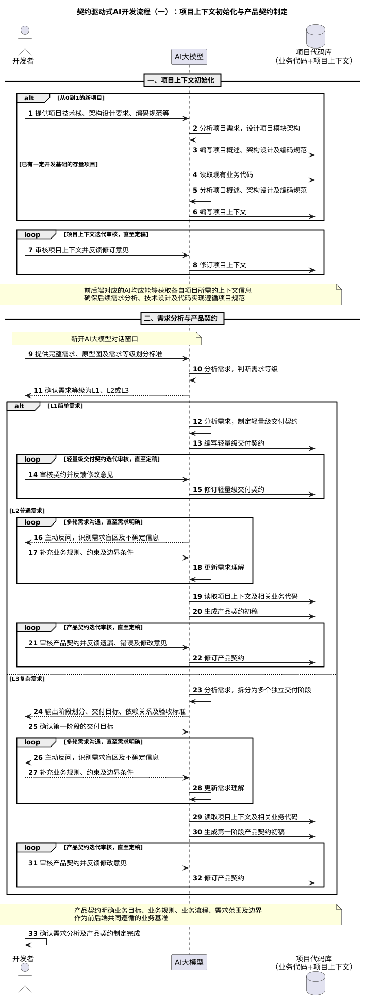
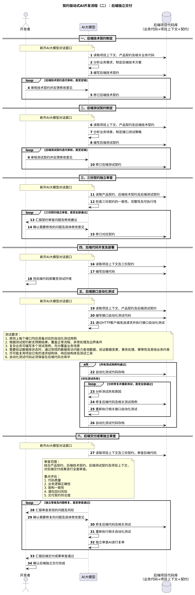
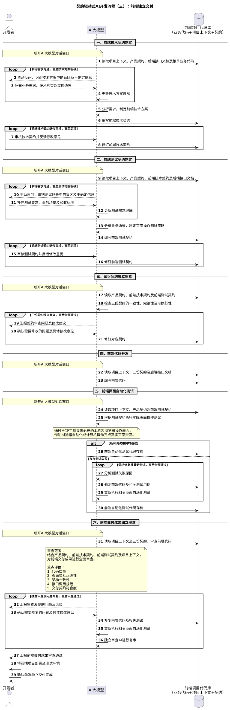

基于上篇文章的流程概述，下面绘制契约驱动式`AI`开发各阶段的时序图。

项目上下文初始化与产品契约制定，其时序图如下所示：



后端独立交付，其时序图如下所示：



前端独立交付，其时序图如下所示：



后续进入前后端整体验收阶段，由开发者进行人工联调与业务流程验收，确认功能符合预期后，将前后端项目部署上线。同时，将本次交付契约归档至对应代码仓库，并关联相关代码提交记录或发布版本，最终完成本次需求的正式交付。该阶段的时序图暂不绘制。

项目上下文初始化与产品契约制定，其`PlantUML`如下所示：

```scss
@startuml
title 契约驱动式AI开发流程（一）：项目上下文初始化与产品契约制定

autonumber
actor 开发者
participant "AI大模型" as AI
database "项目代码库\n（业务代码+项目上下文）" as Repo

== 一、项目上下文初始化 ==

alt 从0到1的新项目

    开发者 -> AI: 提供项目技术栈、架构设计要求、编码规范等
    AI -> AI: 分析项目需求，设计项目模块架构
    AI -> Repo: 编写项目概述、架构设计及编码规范

else 已有一定开发基础的存量项目

    AI -> Repo: 读取现有业务代码
    AI -> AI: 分析项目概述、架构设计及编码规范
    AI -> Repo: 编写项目上下文

end

loop 项目上下文迭代审核，直至定稿

    开发者 -> AI: 审核项目上下文并反馈修订意见
    AI -> Repo: 修订项目上下文

end

note over 开发者,Repo
前后端对应的AI均应能够获取各自项目所需的上下文信息
确保后续需求分析、技术设计及代码实现遵循项目规范
end note

== 二、需求分析与产品契约 ==

note over 开发者,AI
新开AI大模型对话窗口
end note

开发者 -> AI: 提供完整需求、原型图及需求等级划分标准
AI -> AI: 分析需求，判断需求等级
AI --> 开发者: 确认需求等级为L1、L2或L3

alt L1简单需求

    AI -> AI: 分析需求，制定轻量级交付契约
    AI -> Repo: 编写轻量级交付契约

    loop 轻量级交付契约迭代审核，直至定稿

        开发者 -> AI: 审核契约并反馈修改意见
        AI -> Repo: 修订轻量级交付契约

    end

else L2普通需求

    loop 多轮需求沟通，直至需求明确

        AI --> 开发者: 主动反问，识别需求盲区及不确定信息
        开发者 --> AI: 补充业务规则、约束及边界条件
        AI -> AI: 更新需求理解

    end

    AI -> Repo: 读取项目上下文及相关业务代码
    AI -> Repo: 生成产品契约初稿

    loop 产品契约迭代审核，直至定稿

        开发者 -> AI: 审核产品契约并反馈遗漏、错误及修改意见
        AI -> Repo: 修订产品契约

    end

else L3复杂需求

    AI -> AI: 分析需求，拆分为多个独立交付阶段
    AI --> 开发者: 输出阶段划分、交付目标、依赖关系及验收标准

    开发者 -> AI: 确认第一阶段的交付目标

    loop 多轮需求沟通，直至需求明确

        AI --> 开发者: 主动反问，识别需求盲区及不确定信息
        开发者 --> AI: 补充业务规则、约束及边界条件
        AI -> AI: 更新需求理解

    end

    AI -> Repo: 读取项目上下文及相关业务代码
    AI -> Repo: 生成第一阶段产品契约初稿

    loop 产品契约迭代审核，直至定稿

        开发者 -> AI: 审核产品契约并反馈修改意见
        AI -> Repo: 修订产品契约

    end

end

note over 开发者,Repo
产品契约明确业务目标、业务规则、业务流程、需求范围及边界
作为前后端共同遵循的业务基准
end note

开发者 -> 开发者: 确认需求分析及产品契约制定完成
@enduml
```

后端独立交付，其`PlantUML`如下所示：

```scss
@startuml
title 契约驱动式AI开发流程（二）：后端独立交付

autonumber
actor 开发者
participant "AI大模型" as AI
database "后端项目代码库\n（业务代码+项目上下文+契约）" as Repo

== 一、后端技术契约制定 ==

note over 开发者,AI
新开AI大模型对话窗口
end note

AI -> Repo: 读取项目上下文、产品契约及相关业务代码
AI -> AI: 分析业务需求，制定后端技术方案
AI -> Repo: 编写后端技术契约

loop 后端技术契约迭代审核，直至定稿

    开发者 -> AI: 审核技术契约并反馈修改意见
    AI -> Repo: 修订后端技术契约

end

== 二、后端测试契约制定 ==

note over 开发者,AI
新开AI大模型对话窗口
end note

AI -> Repo: 读取项目上下文、产品契约及后端技术契约
AI -> AI: 分析业务场景，制定接口测试策略
AI -> Repo: 编写后端测试契约

loop 后端测试契约迭代审核，直至定稿

    开发者 -> AI: 审核测试契约并反馈修改意见
    AI -> Repo: 修订后端测试契约

end

== 三、三份契约独立审查 ==

note over 开发者,AI
新开AI大模型对话窗口
end note

AI -> Repo: 读取产品契约、后端技术契约及后端测试契约
AI -> AI: 检查三份契约的一致性、完整性及可执行性

loop 三份契约独立审查，直至全部通过

    AI --> 开发者: 汇报契约审查问题及修改建议
    开发者 --> AI: 确认需要修改的问题及具体修改意见
    AI -> Repo: 修订对应契约

end

== 四、后端代码开发及部署 ==

note over 开发者,AI
新开AI大模型对话窗口
end note

AI -> Repo: 读取项目上下文及三份契约
AI -> Repo: 编写后端代码
开发者 -> 开发者: 将后端代码部署至测试环境

== 五、后端接口自动化测试 ==

note over 开发者,AI
新开AI大模型对话窗口
end note

AI -> Repo: 读取项目上下文、产品契约及后端测试契约
AI -> Repo: 编写接口自动化测试代码
AI -> AI: 通过HTTP客户端发送请求并执行接口自动化测试

note over AI
测试要求：
1. 原则上每个接口均应具备对应的自动化测试用例
2. 根据测试契约断言预期结果，覆盖正常流程、异常处理及边界条件
3. 复杂业务可编写多个测试用例，充分覆盖业务场景
4. 需要验证数据库状态时，通过受控的数据库访问能力查询数据，验证数据变更、事务处理、幂等性及其他业务约束
5. 尽可能复用项目已有的请求结构体、响应结构体及测试工具
6. 自动化测试代码必须保留在后端代码仓库中
end note

alt 所有测试用例均通过

    AI -> Repo: 自动化测试代码存档

else 存在测试失败

    loop 分析修复并重新测试，直至全部通过

        AI -> AI: 分析测试失败原因
        AI -> Repo: 修复后端代码及相关测试用例
        AI -> AI: 重新执行相关接口自动化测试

    end

    AI -> Repo: 自动化测试代码存档

end

== 六、后端交付成果独立审查 ==

note over 开发者,AI
新开AI大模型对话窗口
end note

AI -> Repo: 读取项目上下文及三份契约，审查后端代码

note over AI
审查范围：
结合产品契约、后端技术契约、后端测试契约及项目上下文，
对后端交付成果进行全面审查。

重点评估：
1. 代码质量
2. 业务逻辑正确性
3. 架构一致性
4. 潜在回归风险
5. 交付契约符合度
end note

loop 独立审查及问题修复，直至审查通过

    AI --> 开发者: 汇报审查发现的问题及风险
    开发者 --> AI: 确认需要修复的问题及具体修改意见

    AI -> Repo: 修复后端代码及相关测试
    AI -> AI: 重新执行相关自动化测试
    AI -> AI: 独立审查AI进行复审

end

AI --> 开发者: 汇报后端交付成果审查通过
开发者 -> 开发者: 确认后端独立交付完成
@enduml
```

前端独立交付，其`PlantUML`如下所示：

```scss
@startuml
title 契约驱动式AI开发流程（三）：前端独立交付

autonumber
actor 开发者
participant "AI大模型" as AI
database "前端项目代码库\n（业务代码+项目上下文+契约）" as Repo

== 一、前端技术契约制定 ==

note over 开发者,AI
新开AI大模型对话窗口
end note

AI -> Repo: 读取项目上下文、产品契约、后端接口文档及相关业务代码

loop 多轮需求沟通，直至技术方案明确

    AI --> 开发者: 主动反问，识别技术方案中的盲区及不确定信息
    开发者 --> AI: 补充业务要求、技术约束及实现边界
    AI -> AI: 更新技术方案理解

end

AI -> AI: 分析需求，制定前端技术方案
AI -> Repo: 编写前端技术契约

loop 前端技术契约迭代审核，直至定稿

    开发者 -> AI: 审核技术契约并反馈修改意见
    AI -> Repo: 修订前端技术契约

end

== 二、前端测试契约制定 ==

note over 开发者,AI
新开AI大模型对话窗口
end note

AI -> Repo: 读取项目上下文、产品契约、前端技术契约及后端接口文档

loop 多轮需求沟通，直至测试范围明确

    AI --> 开发者: 主动反问，识别测试场景中的盲区及不确定信息
    开发者 --> AI: 补充测试要求、业务场景及验收标准
    AI -> AI: 更新测试需求理解

end

AI -> AI: 分析业务场景，制定页面操作测试策略
AI -> Repo: 编写前端测试契约

loop 前端测试契约迭代审核，直至定稿

    开发者 -> AI: 审核测试契约并反馈修改意见
    AI -> Repo: 修订前端测试契约

end

== 三、三份契约独立审查 ==

note over 开发者,AI
新开AI大模型对话窗口
end note

AI -> Repo: 读取产品契约、前端技术契约及前端测试契约
AI -> AI: 检查三份契约的一致性、完整性及可执行性

loop 三份契约独立审查，直至全部通过

    AI --> 开发者: 汇报契约审查问题及修改建议
    开发者 --> AI: 确认需要修改的问题及具体修改意见
    AI -> Repo: 修订对应契约

end

== 四、前端代码开发 ==

note over 开发者,AI
新开AI大模型对话窗口
end note

AI -> Repo: 读取项目上下文、三份契约及后端接口文档
AI -> Repo: 编写前端代码

== 五、前端页面自动化测试 ==

note over 开发者,AI
新开AI大模型对话窗口
end note

AI -> Repo: 读取项目上下文、产品契约及前端测试契约
AI -> AI: 根据测试契约执行实际页面操作测试

note over AI
通过MCP工具提供必要的本机及浏览器操作能力，
借助浏览器自动化或计算机操作完成真实页面交互。
end note

alt 所有测试用例均通过

    AI -> Repo: 前端自动化测试代码存档

else 存在测试失败

    loop 分析修复并重新测试，直至全部通过

        AI -> AI: 分析测试失败原因
        AI -> Repo: 修复前端代码及相关测试用例
        AI -> AI: 重新执行相关页面自动化测试

    end

    AI -> Repo: 前端自动化测试代码存档

end

== 六、前端交付成果独立审查 ==

note over 开发者,AI
新开AI大模型对话窗口
end note

AI -> Repo: 读取项目上下文及三份契约，审查前端代码

note over AI
审查范围：
结合产品契约、前端技术契约、前端测试契约及项目上下文，
对前端交付成果进行全面审查。

重点评估：
1. 代码质量
2. 页面交互正确性
3. 架构一致性
4. 接口调用规范
5. 交付契约符合度
end note

loop 独立审查及问题修复，直至审查通过

    AI --> 开发者: 汇报审查发现的问题及风险
    开发者 --> AI: 确认需要修复的问题及具体修改意见

    AI -> Repo: 修复前端代码及相关测试
    AI -> AI: 重新执行相关页面自动化测试
    AI -> AI: 独立审查AI进行复审

end

AI --> 开发者: 汇报前端交付成果审查通过

开发者 -> 开发者: 将前端项目部署至测试环境
开发者 -> 开发者: 确认前端独立交付完成
@enduml
```
